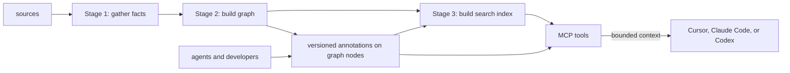
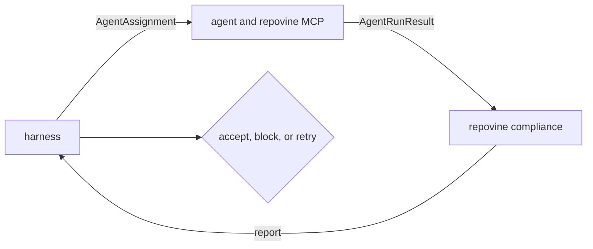
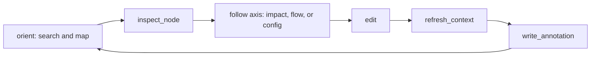
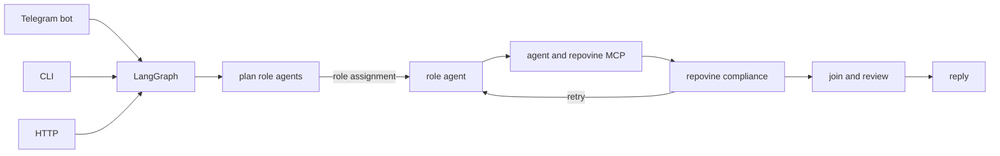

# repovine

[](https://github.com/legann/repovine/actions/workflows/ci.yml)

**Intent-driven, context-compiled, contract-verified development.**

*Codebase knowledge, conveyed at the moment of decision.*

## The open-source repository knowledge layer for coding agents

**A repository-agnostic core.** repovine normalizes a software repository into a queryable context model for coding agents. Its structural layer is a deterministic graph built from source code and infrastructure. TypeScript is first-class; Python currently has partial structural coverage. New languages and infrastructure formats extend through public source and IaC producer contracts; core owns graph identity, ontology, linking, and query semantics.

**Contract boundaries by design.** The graph models cross-unit contract boundaries. The code hierarchy stops at exported symbols; structural relations such as containment, imports, re-exports, `implements`, template composition, and runtime wiring connect those boundaries. This level supports repository-scale navigation, impact, runtime topology, and configuration while source bodies and execution establish implementation behavior.

**Versioned knowledge with explicit ownership.** Version-controlled **annotations** evolve with the repository and form the durable layer for authored repository knowledge. They attach intent, invariants, risks, and operational constraints to graph nodes. Through MCP, coding agents query bounded graph and annotation context while they work. repovine validates the parts of graph and annotation claims that can be compared with repository state. Coding agents own task interpretation, implementation, and behavioral verification. Developers and harnesses own execution policy and final acceptance.

Together, these layers support **intent-driven, context-compiled, contract-verified development**. The agent brings task intent; MCP assembles current repository context; repovine checks observable repository claims. On greenfield work, the client creates the first scaffold and enters the context loop after refresh.

> **Benchmarked on real repositories.** The benchmark covers two task classes: **correctness (change completeness)**, where the requested behavior and its required related updates must be present; and **restraint (scope control)**, where the requested change must land while protected surfaces remain unchanged. Across both classes, **90% of Repovine runs** passed their case-specific diff gate, compared with **12.5% of baseline runs**. [Explore the results](benchmarks/README.md).

**Checkout-local by design.** repovine runs as a stdio MCP server inside each checkout, so its graph reflects the working tree being changed. The live graph and indexes run in memory. No database is required. Configuration, domain layout, and annotations live in Git and provide shared repository context across developers, agents, worktrees, and CI.

Start in an existing repository:

```bash
npx repovine setup claude # or codex, cursor, all
```

## The repovine model

repovine models a repository as a set of cross-unit contract boundaries connected by deterministic structural relations. A boundary becomes a graph level when its meaning survives across languages and another repository unit addresses it as a contract. This yields the `root → package → module → export-symbol` code hierarchy, with templates and runtime resources as parallel contract surfaces. Domains form a logical navigation and scoping layer across the physical graph, grouping related nodes while the containment hierarchy retains repository structure. Below exported symbols, analysis enters implementation internals handled by source inspection, language tooling, and execution.

This cut keeps the graph at the level of repository-wide architectural reasoning. It supports deterministic incremental extraction, durable identities for annotations, and bounded queries for navigation, impact, configuration, and runtime topology. The ontology is query-driven: a primitive belongs in core when it has a deterministic producer and changes the result of a supported query.

Language- and format-specific variability stays at the producer boundary. Source and IaC plugins emit validated facts; core assigns identity and owns ontology, linking, and query semantics. New producers expand extraction coverage while every tool continues to operate on one graph vocabulary. Extraction depth may vary, and unsupported facts remain absent.

Derived facts and authored knowledge follow different trust models. The graph is rebuilt from repository state independently of annotations. Intent, invariants, risks, and operational constraints live in a separate versioned layer. repovine checks freshness and structural consistency from repository state and validates provenance at the write or run boundary; semantic correctness remains an agent and developer verification responsibility.

Delivery follows the same boundary. Task intent comes from the coding agent, so MCP returns bounded results for explicit search and graph queries. Generated client hooks provide a limited pre-edit path for boundary-scoped risks on file-owned nodes. Developers and harnesses retain execution policy, tests, review, and final acceptance because those decisions require evidence beyond repository-observable state.

The same model-agnostic engine supports interactive and autonomous development:

| Mode | What |
|---|---|
| **Client (IDE or CLI)** | MCP delivers scoped graph context and annotations in Cursor, Claude Code, or Codex; a developer stays in the loop and repovine's checks are advisory |
| **Agent Protocol (harness)** | an external harness runs the agent; repovine checks its structured result against the graph and annotation state, while the harness owns tests, retries, and final acceptance. See the [LangGraph harness demo](examples/agent-harness-demo) |

## How it works (Client)



| Stage | Input | Output |
|---|---|---|
| Stage 1: gather facts | sources | exports, imports, env names, routes, infra |
| Stage 2: build graph | facts | packages → modules → symbols; infra/template/domain edges |
| annotations | graph + agent/developer writes | versioned intent, invariants, risks, side effects, and operational constraints |
| Stage 3: build search index | graph + annotations | token index; optional embeddings to assist fuzzy search |
| MCP | graph + annotations + index | bounded graph and annotation query results |

## How it works (Agent Protocol)

repovine provides the protocol: the assignment → result → compliance contract, and the validators that check a run against the repo. A harness applies it: it delivers the task, runs the agent with repovine MCP, and gates on repovine's checks.



Compliance checks the result against the repo; the harness owns the rest:

| repovine checks | harness owns |
|---|---|
| touched nodes resolve in the graph | tests run and pass |
| written annotations exist and are fresh | business logic |
| annotations are consistent and grounded in-session | security, rollout |
| refresh and requested-check claims are reflected in the result | final accept/block |
| result scope within assignment | model, budget, permissions |

## MCP tools

Each tool returns a scoped, structured response.

Query tools, with a typical question on a big repo:

| Group | Example question | Tools |
|---|---|---|
| Navigate | where is auth? what's inside the billing package? | `search_context`, `map_context`, `inspect_node` |
| Runtime | what are the entrypoints? how does an order flow through services? | `get_entrypoints`, `trace_flow` |
| Contracts & config | who breaks if I change this API? what env does the worker read? | `analyze_dependencies`, `get_config_surface` |
| Architecture | any boundary violations or god-modules? | `analyze_architecture` |

Maintenance tools service the graph and annotations:

| Group | Purpose | Tools |
|---|---|---|
| Memory | what's annotated, and what's stale? | `get_annotation_status`, `write_annotation`, `merge_annotations`, `validate_annotations`, `get_annotation_merge_status` |
| Sync | rebuild and check the graph | `refresh_context`, `get_build_status`, `get_context_session_quality` |
| Domains | tune the domain config | `suggest_domains_config` |
| Declines | dismiss reviewed advisory items | `decline_advisory` (kind: `domains-config` \| `carrier-link-gaps`) |

An agent uses these tools in a loop:



After a verified change, the agent re-syncs the graph (`refresh_context`) and records what it learned (`write_annotation`), so committed repository memory reflects the verified workspace. The graph re-derives automatically; agents and developers author the semantic layer within the annotation schema.

## Setup and CLI

| Command | Goal |
|---|---|
| `npx repovine setup cursor` (or `claude`/`codex`/`all`); client plugins _upcoming_ | additive projection of repovine assets into the workspace, preserving existing config; then builds the graph |
| `npx repovine build` | build the graph |
| `npx repovine status` | graph / config / annotation health |
| `npx repovine doctor` | diagnose repovine assets |
| `npx repovine clear` | remove managed assets |
| `npx repovine` | run the stdio MCP server outside an IDE/CLI client |
| `npx repovine --version` · `--help` | version / help |

STDIO is the only supported MCP transport in v1. For remote, devcontainer, WSL, VM, or devbox use, launch the `repovine` subprocess inside that environment so it runs in the checkout being analyzed.

| Asset | What you get |
|---|---|
| MCP server | the repovine MCP tools |
| Skills | `repovine-workflow`, `repovine-annotations`, `repovine-refresh`, `repovine-review`, `repovine-status` |
| Subagents | `repovine-repo-explorer`, `repovine-annotation-writer`, `repovine-architecture-auditor`, `repovine-code-reviewer` |
| Hooks | SessionStart nudges: MCP first, refresh after edits |
| Instructions | `AGENTS.md` (Cursor uses `.cursor/rules`) |

Projects can add specialists from the generated client templates; `setup` preserves them.

## Supported stacks

| Area | Support |
|---|---|
| Languages | **First-class support:** TypeScript (JS/JSX via the TS toolchain, needs `tsconfig.json`); Python partial (backend routes + server-rendered templates) |
| Frameworks | React, Next.js, Nuxt, SvelteKit, Angular, NestJS, serverless monorepos; Vue/Svelte single-file components (script blocks only) |
| IaC | **Partial, expanding coverage:** SAM/CloudFormation, Terraform, Kubernetes, Helm, Dockerfile, docker-compose, Vercel |

IaC parsers turn infra files into runtime-resource nodes plus links to the code and images behind them. They cover selected resources and relationships rather than complete format schemas. Coverage is under active development, and extending the existing extractors is a contribution area. Design detail: [DESIGN.md](DESIGN.md#iac-parser-architecture).

Requires Node.js 22+ and one indexable root: `tsconfig.json`, `pyproject.toml`/`setup.py` (needs `python3`), or IaC files. Infra-only repos build a graph.

## Files in your repo

| File / dir | Git | Role |
|---|---|---|
| `repovine.config.json` | commit | main config: graph build and MCP output |
| `repovine.domains.json` | commit | domain config: naming, grouping, infra noise filters |
| `repovine.annots.json` | commit | semantic annotation memory; one entry per line, merge-friendly |
| `.repovine/` | ignore | local cache: snapshot, calibration, semantic index, state |

Defaults work for most TypeScript repos. Config reference: [docs/workspace-files.md](docs/workspace-files.md).

## Security

repovine stores structure, names, and relationships. It records env var names, never values; `write_annotation` rejects secret-shaped values. Keep tokens and customer data out of issues, fixtures, and annotations.

## Status

Preview (0.1.0), usable today and open to contributions. The graph schema and `@repovine/plugin-sdk` still change.

## Contribute

Plugins are the main way to extend repovine. Two surfaces, both via `@repovine/plugin-sdk`:

| Plugin | What it adds |
|---|---|
| Language source producer | a language: source files → modules, imports, exports, semantic hints |
| IaC parser | an infra format: files → runtime-resource nodes and links |

Built-in TypeScript, Python, and IaC producers use the same public contracts as third-party plugins. Add one in-repo (one bootstrap line) or publish it as an npm package; repovine validates the facts it produces while core retains graph ids and ontology. Plugin guide: [docs/plugin-authoring.md](docs/plugin-authoring.md). Runnable examples: [Go source plugin](examples/repovine-plugin-go), [IaC plugin](examples/repovine-plugin-iac), and the [examples catalog](examples/README.md). Dev setup and other paths: [CONTRIBUTING.md](CONTRIBUTING.md).

Delivery mechanics are the core extension point for edit-relevant signals derived from graph and annotation state. Each mechanic declares the primitive it reads, its propagation direction, delivery channels, and detection rule; when that primitive is unavailable, the mechanic remains dormant. Mechanics stay in core because they consume graph, annotation, and response contracts. See [adding a delivery mechanic](CONTRIBUTING.md#adding-a-delivery-mechanic) and the [mechanics registry](DESIGN.md#mechanics-registry).

## Examples

[Browse all runnable examples](examples/README.md), including plugin authoring,
an offline Agent Protocol fixture, and the live harness below.

[`examples/agent-harness-demo`](examples/agent-harness-demo) is a runnable harness that applies the protocol with LangGraph: channels (Telegram bot, HTTP, CLI), role agents (greenfield scaffolds fan out in parallel git worktrees), and retries. Agents run write-only inside an egress-restricted Docker sandbox. Providers: Claude, Cursor, Codex via API, or a local model.



Guide: [docs/agent-protocol.md](docs/agent-protocol.md).

## Learn more

- [Documentation](docs/README.md): guides, references, and the TODO app walkthrough
- [Platform support](docs/platform-support.md): per-surface OS tiers, prerequisites, and promotion rules
- [DESIGN.md](DESIGN.md): system boundaries, graph contract, trust model, and limitations
- [CONTRIBUTING.md](CONTRIBUTING.md): dev setup, quality gates
- [examples](examples/README.md): runnable plugins and Agent Protocol harnesses

## License

MIT. See [LICENSE](LICENSE).
