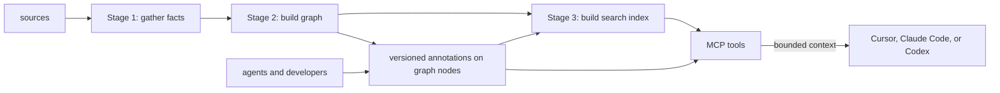
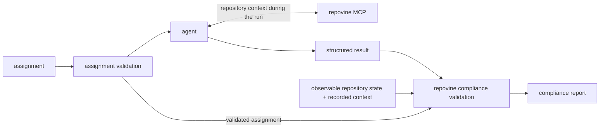

# repovine

[](https://github.com/legann/repovine/actions/workflows/ci.yml)

**Repository context assembled and conveyed to coding agents.**

## The repository knowledge layer

**A repository-agnostic core.** Across supported languages, frameworks, and infrastructure formats, repovine normalizes repository structure into one queryable model.

**Contract boundaries by design.** The graph connects repository units through shared code, template, and runtime contracts. These boundaries support repository-scale navigation, dependency impact, runtime flow, and configuration.

**Versioned knowledge with explicit ownership.** Version-controlled annotations attach intent, invariants, risks, and operational knowledge to graph nodes. Agents and developers author them; repovine checks freshness and structural consistency against repository state.

Together, these layers support **intent-driven, context-compiled, contract-verified development**. Task intent guides MCP context assembly, and observable claims are checked against repository state.

**Checkout-local by design.** The live graph and indexes are built from each checkout's working tree and run in memory. Configuration and authored knowledge travel through Git. No database is required.

**Benchmarks.** Across correctness and restraint tasks drawn from public software repositories, **90% of Repovine runs** passed their case-specific diff gate, compared with **10.6% of baseline runs**. [Explore the results](https://github.com/legann/repovine/blob/main/benchmarks/README.md).

## Quick start

Start in an existing repository:

```bash
npx repovine setup claude # or codex, cursor, all
```

`setup` connects the selected client to repovine, adds repovine skills, hooks, and instructions, and builds the repository graph.

## The graph model

repovine deterministically derives a graph of cross-unit contracts from repository state. Source and infrastructure plugins translate stack-specific structures into the same vocabulary of packages, modules, exported symbols, templates, runtime resources, and their relationships—so navigation, dependency impact, runtime flow, and configuration work consistently across supported stacks. [Explore the design rationale](DESIGN.md#the-contract-boundary-model-why-these-levels).

## How it works

The engine and MCP provide the base workflow. Interactive clients use it directly. For explicit protocol runs, Delivery Protocol adds a structured assignment → result → compliance contract around the same workflow.

### Client

In clients such as Claude Code, Codex, or Cursor, the agent uses repovine MCP directly while the developer stays in the loop.



| Stage | Input | Output |
|---|---|---|
| Stage 1: gather facts | sources | exports, imports, env names, routes, infra |
| Stage 2: build graph | facts | packages → modules → symbols; infra/template/domain edges |
| annotations | graph + agent/developer writes | versioned intent, invariants, risks, side effects, and operational constraints |
| Stage 3: build search index | graph + annotations | token index; optional embeddings to assist fuzzy search |
| MCP | graph + annotations + index | bounded graph and annotation query results |

### Delivery Protocol

Delivery Protocol defines the assignment → structured result → compliance report contract. Core owns the schemas, projections, and validators that ground the protocol in observable repository state.

The agent uses MCP to access repository context while it works. The repovine CLI validates the assignment and result and produces the compliance report.



repovine validates schema conformance, assignment linkage, and claims it can recompute from the graph, annotations, recorded MCP context, and an optional revision delta. The compliance report covers protocol conformance and repository grounding; behavioral correctness and merge readiness are outside the protocol's scope.

The runnable [LangGraph harness demo](https://github.com/legann/repovine/blob/main/examples/delivery-protocol-harness-demo) applies the protocol in an end-to-end agent workflow. Its orchestration topology, sandbox, retries, worktree isolation, and provider behavior are demo-specific implementation choices. See the [Delivery Protocol integration guide](docs/delivery-protocol.md).

## MCP tools

Each tool returns a scoped, structured response.

Query tools, with typical questions for a large repository:

| Group | Example question | Tools |
|---|---|---|
| Navigate | where is authentication? what is inside the billing package? | `search_context`, `map_context`, `inspect_node` |
| Runtime | what are the entrypoints? how does an order flow through services? | `get_entrypoints`, `trace_flow` |
| Contracts & config | which consumers are affected by an API change? which environment variables does the worker read? | `analyze_dependencies`, `get_config_surface` |
| Architecture | are there boundary violations or god modules? | `analyze_architecture` |

Maintenance tools service the graph and annotations:

| Group | Purpose | Tools |
|---|---|---|
| Memory | which nodes are annotated or stale? | `get_annotation_status`, `write_annotation`, `merge_annotations`, `validate_annotations`, `get_annotation_merge_status` |
| Sync | rebuild and check the graph | `refresh_context`, `get_build_status`, `get_context_session_quality` |
| Domains | tune the domain config | `suggest_domains_config` |
| Declines | dismiss reviewed advisory items | `decline_advisory` (kind: `domains-config` \| `carrier-link-gaps`) |

## Setup and CLI

`setup` adds the following repovine integrations to the workspace while preserving existing configuration and project specialists:

| Integration | Included |
|---|---|
| MCP server | the repovine MCP tools |
| Skills | `repovine-workflow`, `repovine-annotations`, `repovine-refresh`, `repovine-review`, `repovine-status` |
| Subagents | `repovine-repo-explorer`, `repovine-annotation-writer`, `repovine-architecture-auditor`, `repovine-code-reviewer` |
| Hooks | pre-edit boundary notice, post-edit stale-graph notice, session-start "MCP first" reminder |
| Instructions | `AGENTS.md` (Cursor uses `.cursor/rules`) |

| Command | Goal |
|---|---|
| `npx repovine` | run the stdio MCP server outside an IDE/CLI client |
| `npx repovine setup cursor` (or `claude`/`codex`/`all`) | add the integrations above, then build the graph |
| `npx repovine build` | build the graph |
| `npx repovine status` | graph / config / annotation health |
| `npx repovine doctor` | diagnose the workspace integration |
| `npx repovine clear` | remove repovine-managed workspace files |
| `npx repovine --version` · `--help` | version / help |
| `npx repovine delivery --help` | harness/CI Delivery Protocol commands: descriptor, manifests, run brief, validation, and compliance |
| `npx repovine agents --help` | harness/CI utilities for repository roles, deterministic orientation, and context-session quality |

STDIO is the only supported MCP transport in v1. For remote, devcontainer, WSL, VM, or devbox use, launch the `repovine` subprocess inside that environment so it runs in the checkout being analyzed.

## Supported stacks

| Area | Support |
|---|---|
| Languages | **First-class support:** TypeScript (JS/JSX via the TS toolchain, needs `tsconfig.json`); Python partial (backend routes + server-rendered templates) |
| Frameworks | React, Next.js, Nuxt, SvelteKit, Angular, NestJS, serverless monorepos; Vue/Svelte single-file components (script blocks only) |
| IaC | **Partial, expanding coverage:** SAM/CloudFormation, Terraform, Kubernetes, Helm, Dockerfile, docker-compose, Vercel |

IaC parsers turn infra files into runtime-resource nodes plus links to the code and images behind them. They cover selected resources and relationships rather than complete format schemas. Coverage is under active development, and extending the existing extractors is a contribution area. Design detail: [DESIGN.md](DESIGN.md#iac-parser-architecture).

Requires Node.js 22+ and one indexable root: `tsconfig.json`, `pyproject.toml`/`setup.py` (needs `python3`), or IaC files. Repositories with supported IaC files can be indexed without a source project; the graph contains infrastructure modules and runtime resources, but no code modules.

## Repository files

| File / dir | Git | Role |
|---|---|---|
| `repovine.config.json` | commit | main config: graph build and MCP output |
| `repovine.domains.json` | commit | logical organization of the repository graph |
| `repovine.annots.json` | commit | semantic annotation memory |
| `.repovine/` | ignore | local engine cache and workspace state |

Defaults work for most TypeScript repositories. Config reference: [docs/workspace-files.md](docs/workspace-files.md).

## Status

Preview (0.1.0), usable today and open to contributions. The graph schema and `@repovine/plugin-sdk` still change.

## Contribute

repovine's plugin architecture provides two public producer surfaces for extending language and infrastructure coverage, both exposed by `@repovine/plugin-sdk`:

| Plugin | What it adds |
|---|---|
| Language source producer | a language: source files → modules, imports, exports, semantic hints |
| IaC parser | an infra format: files → runtime-resource nodes and links |

Built-in and third-party producers share the same public plugin contracts; core validates their output and owns graph identities and ontology. See the [plugin guide](docs/plugin-authoring.md) and runnable [Go source plugin](https://github.com/legann/repovine/blob/main/examples/repovine-plugin-go), [IaC plugin](https://github.com/legann/repovine/blob/main/examples/repovine-plugin-iac), and [other examples](https://github.com/legann/repovine/blob/main/examples/README.md).

## Learn more

- [DESIGN.md](DESIGN.md): system boundaries, graph contract, trust model, and limitations
- [CONTRIBUTING.md](https://github.com/legann/repovine/blob/main/CONTRIBUTING.md): dev setup, quality gates
- [Documentation](docs/README.md): guides, references, and the TODO app walkthrough
- [Platform support](docs/platform-support.md): per-surface OS tiers, prerequisites, and promotion rules
- [examples](https://github.com/legann/repovine/blob/main/examples/README.md): runnable plugins and the Delivery Protocol harness demo

## License

MIT. See [LICENSE](LICENSE).
