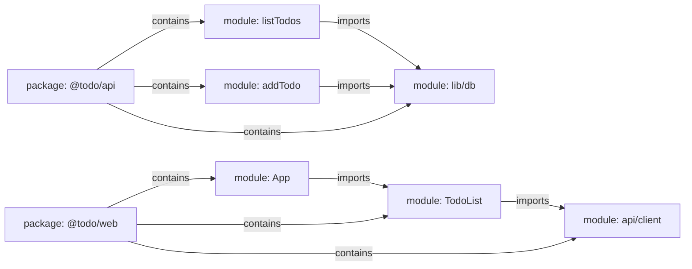
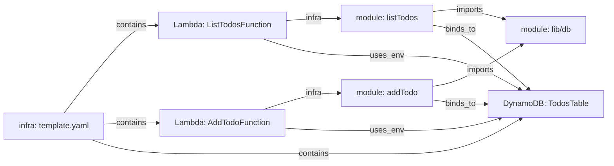
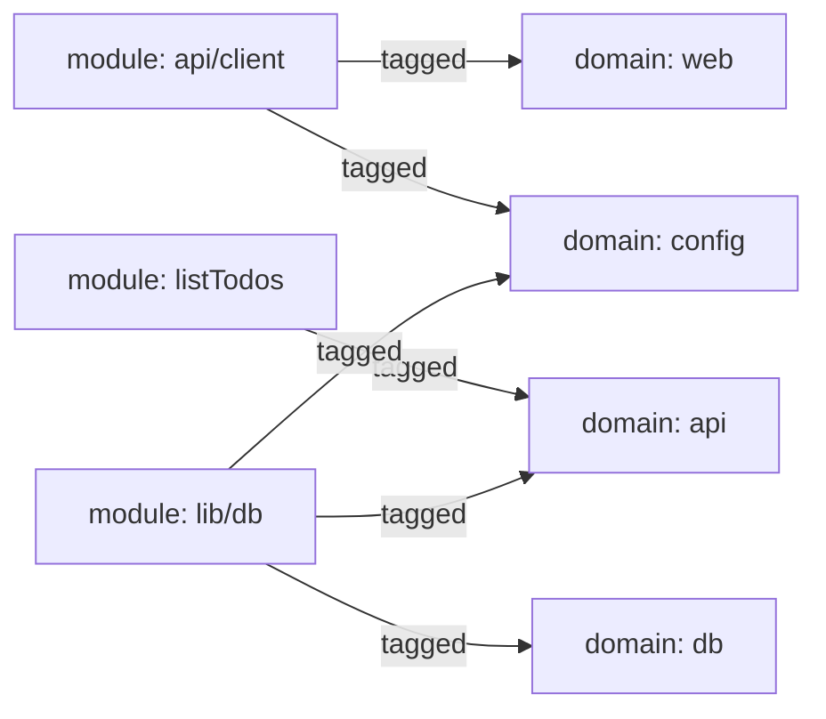
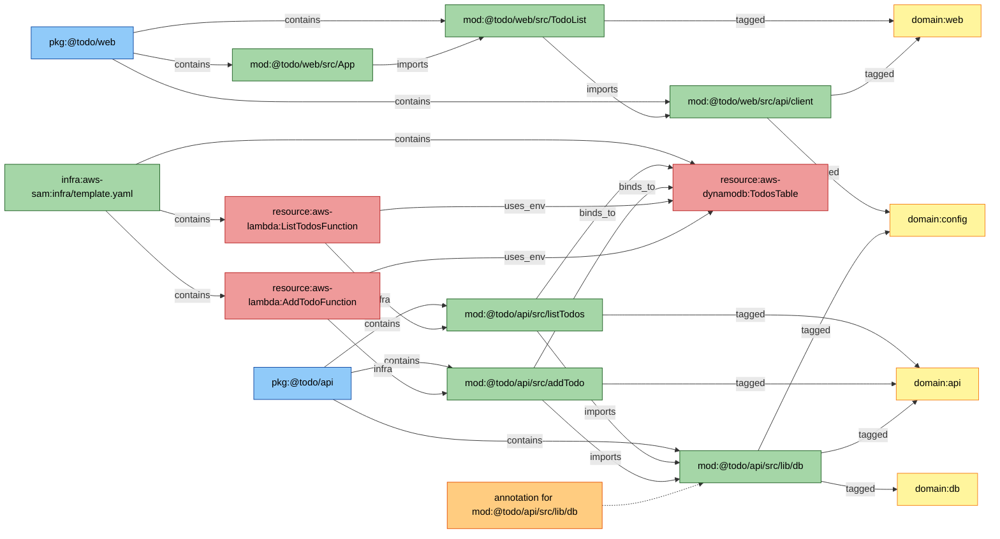

# TODO app: from files to repository context

This walkthrough uses a small React + Lambda + DynamoDB application to show how
repovine assembles its context model. The goal is to answer one question:

> How does the application read the TODO list, and what should an agent inspect
> before changing that flow?

## 1. The repository

The application has a browser package, an API package, and one SAM template:

```text
todo/
├── packages/web/src/
│   ├── App.tsx
│   ├── TodoList.tsx
│   └── api/client.ts
├── packages/api/src/
│   ├── listTodos.ts
│   ├── addTodo.ts
│   └── lib/db.ts
└── infra/template.yaml
```

In this example, `api/client.ts` reads a public API base URL from an environment
variable, while `lib/db.ts` reads `TABLE_NAME`. The SAM template passes
`TABLE_NAME` to both Lambda functions by referencing `TodosTable`. Those facts
are what produce the configuration and runtime links shown below.

Reading these files individually reveals local implementation. It does not yet
provide one navigable model of ownership, dependencies, deployed resources, or
repository-specific constraints.

On refresh, repovine derives the source structure, runtime links, and domains
described in the next three sections. No one constructs those layers by hand in
this example; authored repository knowledge begins with the annotation layer
introduced afterward.

## 2. Source structure from the build

Source plugins normalize supported repository structures into stable graph
nodes. For this application, packages own modules and imports connect modules:



At this layer:

- `contains` records ownership.
- `imports` records static code dependency.
- modules and exports have stable ids that later queries can reference.

This is enough to move from `TodoList` to its browser client, or from an API
handler to the shared database adapter. It does not explain how infrastructure
dispatches into those handlers.

## 3. Runtime structure from IaC

The SAM template contributes runtime-resource nodes. repovine links resources to
the source handlers and resource bindings it can resolve:



The model now crosses the code/IaC boundary: a runtime function resolves to a
handler, and handlers resolve to the table they use. These edges are grounded in
source and infrastructure facts; they are not an inferred architecture story.

## 4. Generated domains for navigation

Folders and packages describe ownership. They do not fully describe the concerns
an agent may need to navigate. Domains add an overlapping navigation layer:



Domain membership is additive. `db.ts` can participate in `api`, `config`, and
`db` at the same time. A domain is therefore an overlay on the graph, not another
folder tree and not exclusive ownership.

## 5. Authored repository knowledge

The graph can identify `mod:@todo/api/src/lib/db`, its importers and environment
names, then follow its handler flow to resolved runtime-resource links. It cannot
derive every invariant or operational risk from syntax. Version-controlled
annotations add that repository knowledge to the same node id:

```json
{
  "summary": "Reads and writes Todo records in DynamoDB using TABLE_NAME.",
  "sideEffects": [
    { "kind": "io-read", "subtype": "db" },
    { "kind": "io-write", "subtype": "db" },
    { "kind": "io-read", "subtype": "env", "description": "TABLE_NAME" }
  ],
  "invariants": ["TABLE_NAME is runtime configuration, not a browser value."],
  "risks": ["Retries and throttling behavior are not visible from graph structure."]
}
```

Annotations are not additional graph nodes. They are authored metadata keyed to
module, domain, resource, or other supported node ids. The graph gets the agent
to the relevant surface; the annotation preserves intent, invariants, and risks
that syntax alone cannot recover.

## 6. Following a question through the model

Now follow the original question: how does the application read the TODO list?

When inspection reaches the browser client, repovine surfaces its `fetch` hint
without creating a deterministic dependency from `@todo/web` to `@todo/api`.
The agent can therefore distinguish a graph fact from a lead that still requires
source inspection.

| Step | Query | What the agent learns |
|---:|---|---|
| 1 | `search_context({ "query": "load todo list" })` | Likely starting points include the UI list, API handler, and related repository concepts. |
| 2 | `inspect_node({ "nodeId": "mod:@todo/web/src/TodoList" })` | `TodoList` belongs to the web package and imports the browser client. |
| 3 | `inspect_node({ "nodeId": "mod:@todo/web/src/api/client" })` | The client contains a fetch hint, but no deterministic web-to-API package edge is claimed. |
| 4 | `trace_flow({ "scope": "resource:aws-lambda:ListTodosFunction" })` | The deployed function resolves to `listTodos`, then to the database adapter and table binding. |
| 5 | `get_config_surface({ "scope": "mod:@todo/api/src/lib/db" })` | The database adapter reads the `TABLE_NAME` environment name. |
| 6 | `analyze_dependencies({ "scope": "mod:@todo/api/src/lib/db", "mode": "impact" })` | Both read and write handlers depend on the shared adapter. |
| 7 | Read the annotation on `mod:@todo/api/src/lib/db` | A change must preserve the runtime-config boundary and account for database side effects and risks. |

The result is a bounded inspection path rather than a claim that every nearby
file must change:

```text
TodoList -> browser client
          [fetch hint; inspect the API boundary]
ListTodosFunction -> listTodos -> db -> TodosTable
                                 └─ annotation: config invariant + DB effects
```

## 7. The complete picture

The layers above compose into one context model. This final diagram is a compact
view of the walkthrough, not a claim that every export symbol or derived domain
is shown. The orange box visualizes metadata attached to an existing node id; it
is not an additional graph node.



The completed model separates three kinds of repository context:

- deterministic structure: ownership, imports, runtime resources, and resolved links;
- navigation overlays: additive domains and bounded search paths;
- authored knowledge: version-controlled annotations on existing node ids.

An agent can now start from a task, retrieve a scoped slice of this model, inspect
the relevant source, and state both what the repository proves and where further
investigation is required.
