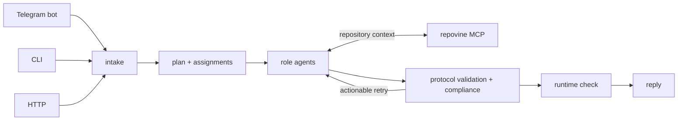
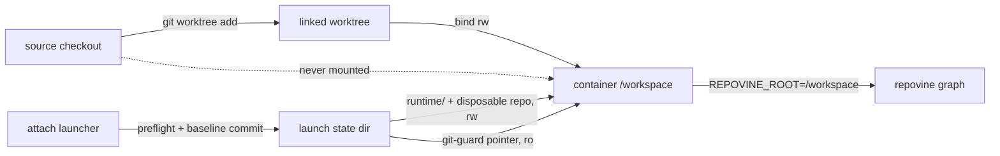

# Delivery Protocol Harness Demo

A **runnable example harness** that executes goals with the supported Claude and
local OpenAI-compatible provider adapters under the
**repovine Delivery Protocol**. It demonstrates the protocol with a third-party
workflow engine — here **LangGraph JS** — without repovine running or scheduling
the agent itself.

A goal becomes a **validated request**. In the Docker deployment shown below, the
container is the sandbox: the worker writes only its workspace bind mount, and an
egress-gw proxy restricts outbound traffic to `anthropic.com`. The worker holds a
placeholder token and reaches Anthropic through the proxy, which holds the real
credential. Its output is normalized to an `AgentRunResult`. repovine validates
the protocol result and its compliance claims;
the harness owns runtime checks, optional review, retry policy, and final
acceptance. Eligible compliance failures with actionable feedback are retried
within the configured budget. The protocol lives in repovine core; this example
shows one way to execute it.

**Support status:** this is a runnable example and integration proof, not a
packaged or canonical harness. It is not part of the `repovine` npm package and
may change with the protocol. Deterministic CLI contract coverage lives in the
[Delivery Protocol blackbox test](../../test/integration/delivery-protocol-cli-blackbox.test.ts).

## End-to-end flow

The CLI, HTTP, and Telegram channels invoke the same LangGraph workflow. It plans
the work, runs role agents with repovine MCP, validates protocol results, applies
the demo's retry and runtime-check policy, and composes a reply.



## What this demonstrates

1. **The protocol is the contract, not the framework.** The canonical schemas and
   validators live in repovine core (`src/agents/protocol.ts` and
   `src/agents/validation.ts`). Every run flows through one
   fixed cycle:

   ```text
   task → validated request → agent runs (sandboxed) → result checked against the repo → reply
                            ▲                                          │
                            └──  retry eligible compliance failures  ──┘
   ```

2. **Orchestrator and harness are cleanly separated from repovine.** repovine owns
   the protocol and compliance validation; it *never* runs the agent. The harness
   runs the worker and owns acceptance policy. Swap LangGraph for Temporal /
   Inngest / BullMQ and the same protocol boundary stays put — the orchestrator is
   the variable.

3. **Provider output crosses the harness boundary as structured claims.** Every
   adapter normalizes its worker output to an `AgentRunResult`; the local adapter
   can synthesize it from observed file and MCP actions. repovine checks that
   result against the sandbox's graph, annotations, and recorded MCP context.

4. **Two repovine surfaces, by design.** The orchestrator validates through the
   repovine **CLI** at the step boundaries; the agent itself uses repovine **MCP**
   *inside* its run, scoped to the sandbox.

5. **Real agents only — the checks have teeth.** No mock path: missing required
   provider configuration yields a *blocked* result (never silent spend), and a
   result that does not hold up against the repository is rejected. Eligible
   actionable compliance failures are retried within the configured budget.
   Blocked results split into two retriable classes: a transport death (stream
   died before work) replays the assignment fresh; a wall-clock timeout of a
   live worker retries fresh with a time-box directive folded into the task.
   Any other blocked result is terminal.

## Vocabulary

| Term | Meaning |
|---|---|
| goal | The outcome the user states (`/goal …`; the wire keeps `task`) |
| claims | Verifiable acceptance contracts the orient phase sharpens the goal into |
| lore | The repovine graph + annotations: the repo's accumulated knowledge, shared across episodes |
| episode | One bounded run at the goal. Every element inside carries a budget: worker wall-clock, retries, gates |
| role | Identity + ownership unit: id, scope, brief. Bundled (demo registry) or project-owned (`agents.roles` in the target repo's config) |
| brief | The role's prose; goes into the worker prompt byte-for-byte |
| sub-agent | A running instance of a role inside an episode: one validated protocol run |
| feedback | The verification path: runtime check, claim verify, review |
| verdict | The channel card: `✅ Goal delivered` / `✅ Process clean` — goal outcome, then protocol conformance |
| reconciliation loop | *(design intent — not yet implemented)* The outer channel loop. A standing goal spawns episodes until observed state matches the goal |
| greenfield | Empty sandbox, no lore yet. Scaffold roles fan out in parallel worktrees; the first pass is exempt from context scoring |
| continuation | Episodes over lore the harness built. Always sequential; contracts propagate through the refresh barrier |

## How it works — division of responsibility

| Layer | Owns | Never does |
|---|---|---|
| **repovine core** | Repository graph, annotations, MCP/CLI tools, Delivery Protocol schemas, compliance validation, generated agent projections | Run, schedule, isolate, retry, or pay for the agent |
| **This harness** | Turn the goal into an assignment, run the live worker, normalize its result, call repovine validation, run acceptance checks and optional review, retry or block, report | Define the protocol or rebuild the graph engine |
| **LangGraph** | Step order, branching, retries, and per-thread in-process checkpoints through `MemorySaver` — the swappable workflow engine | Pick the LLM, validate repository claims, define protocol schemas |
| **Agent** (Claude/local) | Reason, operate within the configured workspace and execution policy, explore via repovine MCP during its run, produce output for normalization | Decide final acceptance or define protocol and compliance policy |

Multi‑agent runs apply the **same** request → run → check loop to every sub‑agent,
each validated on its own.

Core principles:

- **The container is the sandbox.** The rootfs is read-only; writes land only on the
  workspace bind mount. The egress-gw proxy restricts outbound traffic to
  `anthropic.com` and holds the real Anthropic credential. The worker sets
  `ANTHROPIC_BASE_URL` to the proxy and carries only a placeholder token, so it holds
  no usable secret and cannot choose an egress target. Telegram egress opens only when
  `EGRESS_ALLOW_TELEGRAM=1`; the proxy pins every outbound recipient to
  `TELEGRAM_RECIPIENT_IDS`, fail-closed. The Claude Agent SDK's own bubblewrap sandbox
  cannot start nested in this container, so `CLAUDE_SANDBOX` defaults to `0` — required
  to start Claude, not a relaxation. Host mode relies on the selected provider's own
  controls instead. The harness owns configured runtime checks, and you can
  independently inspect and verify the output (see the
  [security posture](docs/usage.md#security-posture-write-only-egress-restricted-hardened-by-default)).
- **Hands‑off retries.** The *harness* — not the agent — decides to retry, and only
  for eligible compliance failures with actionable feedback, within the configured
  retry budget.

## Multi-agent run status (signals)

Multi mode derives run status from observable signals and persists them as a
`signals` block in `summary.json`.

| Signal | Source |
|---|---|
| `treeDiff.changedFiles` | git tree diff `baselineTree..currentTree` via a throwaway index; repovine's committed artifacts excluded. Capture failure → no clean-diff claim (fail-closed) |
| `runtimeStatus` / `runtimeAccepted` | tri-state over `runtime_check`; required = check enabled + a `package.json` exists; required + skipped is not accepted |
| `verificationStatus` / `verificationAccepted` | tri-state over the verify-claims sub-agent; the grounded test floor closes acceptance |
| `testFloorBlockers` | a require-tests sub-agent with no `*.test`/`*.spec` source under its `filesChanged` top-level directories |
| `reviewProcessValid` / `reviewAccepted` | review sub-agent accepted + `complete` + `review` present + fresh tree; acceptance adds `verdict: "approve"` and no blocker/major findings |
| `processOk` / `goalOk` | `processOk` = gate sub-agents + review gate + runtime + verify; `goalOk` = `runtimeAccepted && verificationAccepted && (!reviewRequired \|\| reviewAccepted)` |
| `annotationHealth` | end-state annotation debt after the join cleanup (`repovine status --json` → `{needsWork, clean}`, null = unknown). Drives the card's annotation-sync severity: a sync sub-agent that failed to converge alone is not run debt once a later sweep clears its residual |
| `idleImplementers` | implement-phase sub-agents that completed ok with an empty self-reported `filesChanged` ("already correct" verdicts) — over-plan tax telemetry |
| `planReviewOutcomes` | plan-quality findings reconciled at episode end against each flagged role's own delivery report: `confirmed` (the role completed with an empty `filesChanged`), `refuted` (it completed ok with a non-empty one), `ungradable`. Both readings take the sub-agent's self-report; the tree diff does not reach the grader. Findings are timestamped predictions — never rewritten, only reconciled |

Review freshness uses harness-captured tree oids: a code mutation after the review
invalidates it (`reviewAccepted` false); an annotation-only mutation does not. A
review-fix cycle re-earns acceptance through a full post-fix re-review — acceptance
reads the freshest custody-marked verdict, bounded to one fix cycle per run. The
review sub-agent receives the harness tree-diff in its task; sub-agent self-reported
`filesChanged` is a hint, not the source of truth. Greenfield build plans engage the
full-stack frame: a missing `infra`/`backend`/`frontend` role is injected
(`HARNESS_APP_FRAME` overrides). The plan passes further gates before execution:
a planner-prompt self-check (every role must own a claim), a deterministic
continuation over-plan advisory (`overPlanAdvisories` in `plan_finished`), and an
optional bounded LLM plan review (`HARNESS_PLAN_REVIEW=1`) — one call, at most
three revisions, each must cite an orient claim or graph node, advisory only.
Findings never mutate the plan; they are graded against the episode end state
(`planReviewOutcomes`). Greenfield build plans also fan the scaffold roles
out in parallel git worktrees, merged at join (`HARNESS_GREENFIELD_PARALLEL=0`
disables). Continuation episodes always run sequentially: the inter-stage
`refresh_context` barrier is how real contracts propagate through the lore, and no
parallel override exists for it. Worker sessions never cross the worktree boundary
(provider sessions are cwd-namespaced), so post-parallel annotation sync starts
fresh sessions. Deferred annotation sync, bounded review/runtime fixes,
same-session provider resume, and worktree isolation are this demo's scheduling
decisions, not Delivery Protocol requirements.

## Where to see the protocol

A `/goal` episode produces observable artifacts — that's the point, so look for them:

- **The `.harness/` folder in the sandbox** — the request, the agent's result, and
  the pass/fail verdict for the run.
- **Log lines** — the validate / compliance steps and a `protocol-compliant` (or
  `blocked` / retry) verdict.
- **Channel output** — the CLI exit code, and the status fields returned by HTTP
  `/goal` and `/status`.

The canonical protocol schemas live in repovine core and are documented in
[`../../docs/delivery-protocol.md`](../../docs/delivery-protocol.md). This demo's
node‑by‑node cycle lives in [Design & architecture](docs/langgraph-orchestrator-design.md);
operational detail is in the [usage guide](docs/usage.md).

## Quick start

```bash
cd repovine/examples/delivery-protocol-harness-demo
cp .env.example .env             # set provider credentials, or LOCAL_BASE_URL for local

# First run / Dockerfile changes (plain `docker compose build` builds nothing — profiles are opt-in):
docker compose --profile cli --profile http --profile tg-bot build
```

The image is self‑contained: a builder stage compiles the repovine CLI from
source, so you do **not** need to `npm run build` on the host first. All modes are
**opt‑in** via compose profile; plain `docker compose up` starts nothing. The agent
writes episode output into `./.workspace/sandbox`; for a greenfield goal, that may be
a complete project and may include its own `docker-compose.yml`. The harness runs
configured acceptance checks, and you can inspect or verify the output on the host.

| Mode | Command | Use it for |
|---|---|---|
| **CLI** one‑shot | `npm run docker:cli -- --goal "…"` | CI / a single goal; exit `0` accepts a compliant `complete` or `partial` result |
| **HTTP** handle | `npm run docker:http` | drive with `curl` from another console |
| **Telegram** bot | `npm run docker:tg-bot` | chat‑driven, long‑running |

The `docker:*` scripts call `scripts/compose.mjs`, a Node wrapper that passes
structured argv (no shell globbing) and pre-creates the workspace dir, so they
work the same on Linux, macOS, and Windows. Each builds `--build` (never a stale
image); `npm run docker:down` stops every profile. Compose stays the tool for
`logs`, `ps`, and `exec`.

The **tg-bot** profile additionally needs `EGRESS_ALLOW_TELEGRAM=1` and
`TELEGRAM_RECIPIENT_IDS`; `api.telegram.org` egress is off by default.

Minimal `.env` (Compose injects it into containers; the file is gitignored):

```env
LLM_PROVIDER=claude               # claude | local
CLAUDE_CODE_OAUTH_TOKEN=          # preferred; from `claude setup-token` (proxy-custodied under Docker)
# ANTHROPIC_API_KEY=sk-...        # fallback if you have no subscription token
# Telegram only:
TELEGRAM_BOT_TOKEN=123456:ABC...  # from @BotFather (create your own bot)
TELEGRAM_ALLOWED_IDS=123456789    # inbound: who may message the bot (empty = ignores everyone)
EGRESS_ALLOW_TELEGRAM=1           # open api.telegram.org egress for the tg-bot profile
TELEGRAM_RECIPIENT_IDS=123456789  # outbound: the proxy pins every reply to these ids
```

**No cloud? Run a local model.** Set `LLM_PROVIDER=local` and point
`LOCAL_BASE_URL` at an OpenAI-compatible endpoint (Ollama, vLLM, LM Studio, …) to
drive the same protocol with an open tool-capable model (Qwen / Mistral / Llama / …)
— no key, no vendor SDK. See
[Local models](docs/usage.md#local-models-local--ollama--any-openai-compatible-endpoint).

For Telegram, **create your own bot** with [@BotFather](https://t.me/BotFather) to get
`TELEGRAM_BOT_TOKEN`, and find your numeric id with
[@userinfobot](https://t.me/userinfobot). The id goes in two distinct vars:
`TELEGRAM_ALLOWED_IDS` (inbound — who may message the bot) and `TELEGRAM_RECIPIENT_IDS`
(outbound — the proxy pins every reply to these ids). The tg-bot profile also needs
`EGRESS_ALLOW_TELEGRAM=1`, since `api.telegram.org` egress is off by default. Per‑channel
usage, flags, and curl examples are in the [usage guide](docs/usage.md#channels-in-detail).

## Capabilities

- **`/goal`** — the full protocol cycle: turn the goal into a
  request, run the agent, then check the result against the repo (plus optional
  retry, a build/test pass, and annotation sync). Writes the sandbox.
- **`/ask`** — read‑only Q&A (repo‑aware, no edits, no protocol cycle); sessions
  resume per thread/chat.
- **Multi‑agent + review** — `AGENTS=auto` plans goal-specific roles, while explicit
  `roles` / `subAgents` select them directly. Frontend, backend, and infra are
  examples; every selected sub-agent follows the same handoff and validation loop,
  with an optional review pass.
- **Three channels, one graph** — Telegram, HTTP, and CLI route `/goal` through
  the same compiled workflow. Channel-specific capabilities such as `/ask`,
  sessions, and sandbox reset remain distinct.

| | Telegram | HTTP | CLI |
|---|---|---|---|
| `/goal` (full protocol) | ✅ | `POST /goal` | `--goal` |
| `/ask` (read‑only) | ✅ | `POST /ask` | — |
| multi‑agent / review | `@role` / auto | `roles[]` / `subAgents[]` / `review` | `--roles` / `--review` |
| status | `/status` | `GET /status` | stdout |
| reset sandbox | `/reset` | `POST /reset` | — |

## Target modes

`HARNESS_TARGET_MODE` selects what the worker runs against: the managed sandbox
(default) or a pre-created Git worktree of an existing repository. The attach
walkthrough lives in the
[usage guide](docs/usage.md#attach-mode-existing-repository-worktree).

```bash
# Sandbox (default) — the bot builds inside ./.workspace/sandbox:
npm run docker:tg-bot
# other channels: npm run docker:http · npm run docker:cli -- --goal "…"

# Attach — the same bot against an existing repository:
npm run docker:down                       # stops every profile (sandbox + attach), all shells
npm run attach -- prepare ~/work/myrepo   # [--base <ref>] [--name <run-name>]
npm run attach -- run tg-bot              # rebuilds the image, preflights, starts
# other channels: run http · run cli --goal "…" · preflight = validate only
```

| | `sandbox` (default) | `attach` |
|---|---|---|
| Target creation | harness creates and seeds `./.workspace/sandbox` | operator pre-creates a linked Git worktree, mounted at `/workspace` |
| repovine files | harness seeds config/annotation stubs | the worktree's committed `repovine.config.json` / `repovine.annots.json` (+ optional `repovine.domains.json`) are authoritative; stubs are never written |
| Roles | utility + bundled `frontend`/`backend`/`infra` (JS registry + `lib/agents/*.md`) | utility + the repository's own roles from `agents.roles` in its config (briefs byte-for-byte, read from the launch baseline); without the section — bundled fallback, logged |
| Git | harness inits a sandbox-local repo | launch-scoped disposable repo at `/state/git`; `/workspace/.git` is a read-only pointer (`gitdir: /state/git`) |
| Reset | `/reset` wipes the workspace | `/reset` restores the `attach-baseline` tag (same confirm flow); `attach/run-*` branches survive |
| Revision custody | Git tree objects (`git-tree` backend) | same `git-tree` backend, over the disposable repo (diff + patch bytes) |
| Parallelism | greenfield roles fan out in git worktrees | sequential stages + refresh barriers |
| `.harness` | inside the sandbox on the `.workspace` bind mount | launch-state runtime mount at `/workspace/.harness` |

The attach compose services reuse the hardened image and anchor — read-only
rootfs, `cap_drop: [ALL]`, egress-gw netns, resource ceilings — and run as
`HARNESS_HOST_UID:HARNESS_HOST_GID`. Their mounts:

| Host path | Container path | Access |
|---|---|---|
| `$HARNESS_ATTACH_WORKTREE` (linked worktree) | `/workspace` | rw |
| `$HARNESS_ATTACH_STATE_DIR/runtime/home` | `/state/home` (worker `HOME`) | rw |
| `$HARNESS_ATTACH_STATE_DIR/runtime/harness` | `/workspace/.harness` | rw |
| `$HARNESS_ATTACH_STATE_DIR/runtime/git` (disposable repo) | `/state/git` | rw |
| `$HARNESS_ATTACH_STATE_DIR/control/git-guard` (pointer file) | `/workspace/.git` | ro |
| `./lib/agents` (role briefs) | `HARNESS_AGENTS_DIR` | ro |



The read-only mount shadows the worktree's real `.git` pointer with
`gitdir: /state/git` — a valid pointer into the launch-scoped disposable repo.
The launcher seeds that repo at `run`: one baseline commit of the worktree tree
on branch `attach/work`, tagged `attach-baseline`, identity
`harness <harness@attach>`, `core.worktree=/workspace`. In-container
`git status` / `diff` / `log` work against the baseline. The per-worktree git
dir and the common dir stay host-side.

**The source checkout is never mounted.** The container sees the worktree files
and the disposable repo. Merging into the source repository and teardown are
manual host operations.

Sandbox-parity trade-offs:

| Trade-off | Detail |
|---|---|
| Worker-writable object DB | the agent can write `/state/git` — the posture sandbox accepts for its own `.git` |
| `.gitignore`-driven capture | capture honors the repository's `.gitignore`; a `.gitignore` edit is itself visible in the diff |
| State disk | a compressed copy of the tree plus the agent's objects |
| Launch cost | one baseline commit (seconds on a large repo) |

[`scripts/attach-launcher.mjs`](scripts/attach-launcher.mjs) is the supported
entrypoint:

```bash
npm run attach -- prepare <checkout>   # worktree + empty state from a checkout path (additive only)
npm run attach -- run tg-bot           # full preflight, state layout, compose (also: run http | run cli --goal "…")
npm run attach -- restart tg-bot       # rebuild image + restart the ACTIVE launch, keeping its worktree
npm run attach -- preflight            # validate a launch, creates nothing
```

`prepare` records the launch in `.attach-launch.json`; `preflight`/`run` resolve
it, so the pair needs no env vars. Placement defaults to the checkout's parent;
`HARNESS_ATTACH_ROOT` in `.env` moves launches under `<root>/worktrees|state`.

Promotion is fetch-based. A successful run is committed into the disposable repo
as `attach/run-<runId>` (harness internals excluded); the reply shows
`📦 attach/run-… @ <oid>`:

```bash
git -C <checkout> fetch <state>/runtime/git attach/run-<id>:attach/run-<id>
git -C <checkout> merge attach/run-<id>         # review first: git -C <worktree> diff
```

The worktree file flow remains valid: commit in the worktree (it shares
refs/objects with the source repo) and merge from the checkout — no push:

```bash
git -C <worktree> switch -c attach/run-001 && git -C <worktree> add -A \
  && git -C <worktree> commit -m "attach run-001"
git -C <checkout> merge attach/run-001
```

Discard instead: `npm run docker:down` (stacks both compose files), remove the state
dir, then `git -C <checkout> worktree remove --force <worktree>`. Full lifecycle:
[usage guide](docs/usage.md#attach-mode-existing-repository-worktree).

## Documentation

- **[Usage & operations](docs/usage.md)** — each channel in detail (Telegram
  commands, HTTP API, CLI flags), security posture, attach mode, roles &
  sub‑agents, providers, env vars, host mode, telemetry, process cleanup,
  orchestrator internals, and the file map.
- **[Design & architecture](docs/langgraph-orchestrator-design.md)** — the protocol
  cycle and schema, goals / non‑goals, the layered diagram, the
  [episode state machine](docs/langgraph-orchestrator-design.md#episode-state-machine)
  (phase pipeline, execution modes, the sub-agent attempt loop and its verdict
  classes, feedback/acceptance), multi-agent orchestration, and portability
  rationale.
