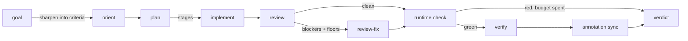
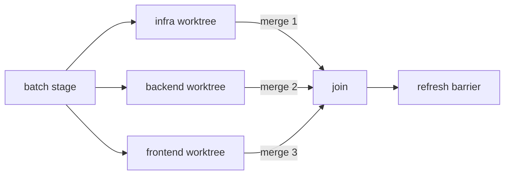
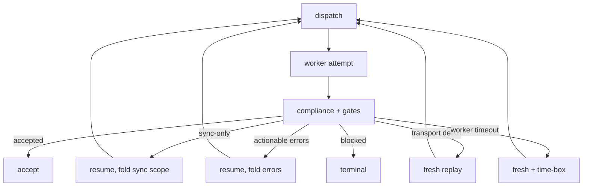
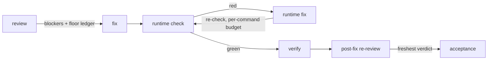

# LangGraph orchestrator + Telegram + repovine Delivery Protocol

Design for a **runnable example harness** that proves repovine Delivery Protocol v1
integrates cleanly with a third-party workflow engine (**LangGraph JS**), without
replacing repovine or duplicating IDE orchestration.

**Status:** implemented, multi-agent shipped.  
**Support status:** runnable example and integration proof; not a packaged or
canonical harness; may change with the protocol.

**Builds on:** [`delivery-protocol-harness-demo`](../README.md), [`delivery-protocol.md`](../../../docs/delivery-protocol.md).
**Operations reference (channels, env, providers, host mode):** [`usage.md`](usage.md).

**Entrypoints:** [`scripts/langgraph-cli.mjs`](../scripts/langgraph-cli.mjs) (CLI) ·
[`scripts/langgraph-tg-bot.mjs`](../scripts/langgraph-tg-bot.mjs) (Telegram) ·
[`scripts/langgraph-http.mjs`](../scripts/langgraph-http.mjs) (HTTP). Graph: [`lib/graph/`](../lib/graph/) ·
workers: [`lib/workers/`](../lib/workers/) · channel: [`lib/channels/telegram-adapter.mjs`](../lib/channels/telegram-adapter.mjs).

---

## Goals

1. **Channel:** Telegram DM → goal input, with **sender ID allowlist** in [`scripts/langgraph-tg-bot.mjs`](../scripts/langgraph-tg-bot.mjs).
2. **Orchestrator:** [**LangGraph**](https://langchain-ai.github.io/langgraphjs/) (JavaScript) owns step order, branching, retries, and persisted graph state — not custom `for` loops in the bot.
3. **Protocol:** Every agent run is wrapped in the **repovine Delivery Protocol** cycle:
   `AgentAssignment` → validate → worker → `AgentRunResult` → validate → `compliance`.
4. **MCP inside the worker step:** repovine MCP (`REPOVINE_ROOT` = sandbox) is available **during** the agent node only; orchestrator nodes call **CLI** `repovine agents …` (same as today’s [`lib/repovine.mjs`](../lib/repovine.mjs)).
5. **Demonstrate portability:** LangGraph is the variable; protocol boundaries stay stable so Temporal / Inngest / BullMQ can reuse the same node functions later.
6. **Real LLM workers only:** every `run_sub_agent` invocation uses a **live provider** (Claude or local). Deterministic protocol and tamper-resistance coverage lives in the [CLI blackbox test](../../../test/integration/delivery-protocol-cli-blackbox.test.ts).

## Non-goals (v1)

- Full IDE-parity multi-agent (Task tool, IDE-client agent auto-spawn) stays out of scope. The v1 baseline was **one worker node** per graph invocation; explicit subagent nodes have since **shipped** (see [Multi-agent orchestration](#multi-agent-orchestration)) — only IDE-parity auto-spawn remains a non-goal.
- Replacing repovine MCP with LangGraph tools (graph tools ≠ repo graph).
- Production Telegram scaling (webhooks, Postgres checkpointer) — long-poll + in-memory checkpointer is enough for the demo.
- Mock / scripted workers inside LangGraph.

---

## Layered architecture

```text
┌─────────────────────────────────────────────────────────────────┐
│  Delivery channel: Telegram                                      │
│  • long-poll getUpdates                                          │
│  • TELEGRAM_ALLOWED_IDS gate (drop silently if not listed)        │
│  • /reset, /new, /help → side paths (not always a full graph run) │
└────────────────────────────┬────────────────────────────────────┘
                             │ Task { id, task, scope, … }
                             ▼
┌─────────────────────────────────────────────────────────────────┐
│  LangGraph orchestrator (NEW)                                    │
│  • State: task, repoRoot, assignment, result, report, sessionId  │
│  • Nodes: protocol gates + worker + notify                       │
│  • Edges: compliance.valid → END | retry / blocked reply         │
└────────────────────────────┬────────────────────────────────────┘
                             │ per-node
         ┌───────────────────┼───────────────────┐
         ▼                   ▼                   ▼
   repovine agents      run_sub_agent          sendMessage
   validate-*           └► provider adapter (Telegram)
   compliance               claude | local
                            + repovine MCP (stdio)
         │                   │
         │                   ├──► egress-gw proxy (loopback 127.0.0.1:8788)
         │                   │      • injects the real anthropic credential (WS-A)
         │                   │      • pins chat_id → TELEGRAM_RECIPIENT_IDS (WS-B)
         │                   │      • default-deny egress → ALLOW_DOMAINS (WS-C)
         │                   │            │ HTTPS
         │                   │            ▼
         │                   │      api.anthropic.com · api.telegram.org
         └───────────────────┴──► sandbox repoRoot (.workspace/sandbox)
```

**LangGraph does not pick the LLM.** It only schedules nodes. The **provider** is selected in `run_sub_agent` via `LLM_PROVIDER` (see below) — same graph, swappable runtime.

**Division of responsibility** (unchanged from Delivery Protocol):

| Layer | Responsibility |
|-------|----------------|
| **repovine core** | Repository graph, annotations, MCP/CLI, Delivery Protocol schemas, validators — never runs the agent |
| **LangGraph** | Scheduling, state, branching, retries — never defines the protocol |
| **Worker** | Reasoning + file edits + MCP exploration — returns structured claims |
| **Telegram** | Transport + allowlist only |

The canonical protocol does **not** live in this demo. It lives in repovine core
(`src/agents/protocol.ts` and `src/agents/validation.ts`) and is documented in
[`delivery-protocol.md`](../../../docs/delivery-protocol.md). This document describes
one harness that consumes that protocol.

The determinism boundary is also intentional:

| Step | Source | How it is checked |
|------|--------|-------------------|
| Assignment construction | Harness code | Schema validation before dispatch |
| Repository context | repovine Stage 1/Stage 2 + annotations | Deterministic MCP/CLI views over sandbox state |
| Worker reasoning and edits | LLM provider | Not trusted directly; must return `AgentRunResult` |
| Result validation | repovine CLI | Schema + compliance against graph nodes, annotations, context session, requested checks |
| Acceptance / retry | Harness policy | LangGraph decides retry/block/accept using repovine's report plus harness-owned checks |

---

## repovine integration points

### Protocol (orchestrator nodes — CLI)

Reuse [`lib/repovine.mjs`](../lib/repovine.mjs) — file-in / JSON-out, `REPOVINE_ROOT=repoRoot`:

| Graph node | CLI / action |
|------------|----------------|
| `build_assignment` | [`buildAssignment`](../lib/assignment.mjs) + write `.harness/<id>.assignment.json` |
| `validate_assignment` | `delivery validate-assignment <file>` |
| `run_sub_agent` | `runAgent(…)` → **provider adapter** (`claude` \| `local`) |
| `validate_result` | `delivery validate-result <file>` |
| `compliance` | `delivery compliance <file> --assignment … [--greenfield-run]` (the flag marks a run that started with no annotated context) |
| multi-agent barriers | `refreshGraph` → `repovine build` (`--cleanup-orphans` on join) |
| worker prompts | `harnessBrief` / `runBrief` → `delivery run-brief` |
| `format_reply` | Map `AgentComplianceReport` → Telegram markdown (reuse `verdictText` from bot) |

Free-form chat goals: pass `manifest: null` to skip implementer-only field nagging (same as Telegram today).

### MCP (inside `run_sub_agent` only)

Each provider adapter launches repovine as stdio MCP with `REPOVINE_ROOT=repoRoot` (same pattern as [`lib/claude-agent.mjs`](../lib/claude-agent.mjs)).

Orchestrator **does not** call MCP for graph navigation — only the worker does during execution.

### Observable cycle (what we prove)

```text
Telegram /goal text
  → LangGraph.invoke({ task, chatId, … })
  → validate-assignment (repovine) — hard stop if invalid
  → worker edits sandbox + MCP
  → validate-result + compliance (repovine)
  → Telegram reply with valid/invalid + summary
```

Protocol tamper resistance is proven by the [CLI blackbox test](../../../test/integration/delivery-protocol-cli-blackbox.test.ts) — not duplicated in the LangGraph bot.

### Annotation-grounding policy (harness-owned, not engine)

repovine is a general validator: it reports annotation-grounding **facts** as structured,
mode-independent observations on the compliance report — `ungroundedAnnotations` (a written
code-module note not `inspect_node`-ed or edited in the same `contextSessionId` — provenance) and
`inconsistentAnnotations` (a written note whose filled `keyExports`/`sideEffects` contradict the
graph). Env mismatches stay advisory (the env detector under-captures) and never appear in these
arrays. The engine's own error/warning severity (client vs harness mode) is unchanged and the
engine knows nothing about this harness.

This **strict harness** applies the policy: any such fact rejects the run. `complianceNode` /
`sub-agent.mjs` use `retry.complianceAccepted(report)` (= repovine `valid` **and** no grounding fact)
instead of `report.valid` alone, so a run repovine marked `valid:true` (facts surfaced as warnings)
is still retried. The existing retry loop handles the rest: such rejections are treated as
**sync-only** (code accepted, fix annotations only) and `retry.retryNotes` folds the offending node
ids into the resumed task. To change strictness (e.g. also reject on advisory env, once its detector
is reliable), edit `lib/graph/retry.mjs` — the engine stays untouched.

---

## LLM providers (worker layer)

LangGraph stays **provider-agnostic**. One graph; at `run_sub_agent` dispatch:

```text
run_sub_agent(state)
  → getWorker(LLM_PROVIDER)   // lib/workers/index.mjs
  → runAgent(task, assignment, repoRoot, { resume, capture })
  → AgentRunResult
```

### Unified seam

Every adapter implements the same signature (async):

```javascript
runAgent(task, assignment, repoRoot, opts?: { resume?, capture? }) => Promise<AgentRunResult>
```

`opts.capture.sessionId` — provider-specific conversation id for Telegram `/new` vs resume.

### Provider matrix

| `LLM_PROVIDER` | Runtime | repovine MCP | Project rules / agents |
|----------------|---------|--------------|------------------------|
| **`claude`** (default) | Claude Agent SDK | stdio `REPOVINE_CLI` | SDK `systemPrompt` + implementer append |
| **`local`** | OpenAI-compatible loop (`lib/workers/local.mjs`) | stdio `REPOVINE_CLI` | prompt brief + `mcp__repovine__*` tools |

Auth for all providers: shared resolver — [Authentication (explicit env only)](#authentication-explicit-env-only).

Role briefs and the write-only harness policy are injected into the worker prompt by the harness. The sandbox does not need provider home/config directories or copied IDE credentials.

---

## Authentication (explicit env only)

### Policy: no silent spend

Same rule as [`lib/claude-agent.mjs`](../lib/claude-agent.mjs) today, extended to **all** providers:

1. **Explicit env keys** are the only accepted provider credentials.
2. Missing keys → `AgentRunResult` `status: 'blocked'` before any LLM call.
3. Home login state, provider credential files, and IDE/CLI auth stores are ignored.

Telegram + long-running bot must not charge against a login the user did not intend.

### Resolution order (`lib/workers/auth.mjs`)

Each adapter calls `resolveAuth(provider)` before run:

```text
1. Explicit environment (provider-specific) → use immediately
2. Otherwise → blocked (message lists the required env var names)
```

Return shape (for logging / blocked messages):

```javascript
{ ok: true, mode: 'explicit', source: string }
// or
{ ok: false, reason: string, hints: string[] }
```

Implement once; **Claude / local adapters must not duplicate** auth logic.

### Explicit environment (per provider)

| Provider | Env vars (any one is enough) |
|----------|------------------------------|
| **claude** | `CLAUDE_CODE_OAUTH_TOKEN` (preferred), `ANTHROPIC_API_KEY` |
| **local** | none — `LOCAL_BASE_URL` + `LOCAL_MODEL` point at the endpoint; no vendor key |

`CLAUDE_CODE_OAUTH_TOKEN` (from `claude setup-token`) is preferred over `ANTHROPIC_API_KEY`: a subscription rate-limit is a smaller blast radius than open billing, and the token is easy to revoke.

### Adapter behavior after `resolveAuth`

| `mode` | Worker action |
|--------|----------------|
| `explicit` | Pass through to SDK; do not log secret values |
| `blocked` | Return `blockedResult(assignment, reason + hints)` — graph continues to `compose_reply` |

**Claude:** accepts `CLAUDE_CODE_OAUTH_TOKEN` or `ANTHROPIC_API_KEY`; `workers/claude.mjs` re-exports the shared Claude worker, which calls `resolveAuth('claude')`. Under Docker Compose the real credential lives in the egress-gw service env; the worker holds only a placeholder and points `ANTHROPIC_BASE_URL` at the proxy (see [Security](#security)).

**local:** no vendor credential; `resolveAuth('local')` passes when `LOCAL_BASE_URL` names an OpenAI-compatible endpoint (Ollama / vLLM / LM Studio / llama.cpp).

Operator commands per provider: [`usage.md` § Providers](usage.md#providers).

### Security

- Never write tokens to `sandbox/`, `.harness/`, or repovine annotations.
- Blocked auth messages list **option names**, not secret values.
- Keep keys in `.env` for Docker Compose or in the process environment for host runs; `.env` is gitignored.

#### Credential custody (egress-gw origin proxy)

Under Docker Compose the anthropic secret never sits in the worker env. The egress-gw
service runs a loopback origin proxy ([`docker/egress-gw/proxy.mjs`](../docker/egress-gw/proxy.mjs), Node).
The real credential (`CLAUDE_CODE_OAUTH_TOKEN` or `ANTHROPIC_API_KEY`) lives in the
egress-gw service env. The claude worker sets `ANTHROPIC_BASE_URL` to the proxy
(`http://127.0.0.1:8788`) and holds only a **placeholder** token.

The proxy terminates plain HTTP on loopback, overwrites the `Authorization` header
with the real credential, and re-originates to `api.anthropic.com` over HTTPS,
streaming SSE back to the worker. The agent holds no usable secret and cannot choose
an egress target.

This relocates custody; it does not relax the no-silent-spend policy. Explicit env
keys remain the only accepted credential (§ [Policy: no silent spend](#policy-no-silent-spend)).
The operator provides the real key to the gateway; the worker sees a placeholder.

### Per-provider session keys (Telegram state)

| Provider | Resume field in graph / adapter state |
|----------|--------------------------------------|
| `claude` | Claude `session_id` |
| `local` | none — the OpenAI-compatible loop is stateless per invocation |

Store in graph state as `workerSessions` (a per-role map of opaque resume handles), not a Claude-specific `sessionId` only.

### Failure modes

- `resolveAuth` not ok → `AgentRunResult` `status: 'blocked'`, `blockers[]` lists the explicit env var names to set (no silent spend).
- Unknown `LLM_PROVIDER` → fail at graph `intake` before any provider call.

---

## LangGraph design (JavaScript)

> **As built.** The sections below describe what shipped. The multi-agent layer
> is detailed separately under [Multi-agent orchestration](#multi-agent-orchestration).

### Dependencies (as built)

```json
{
  "@anthropic-ai/claude-agent-sdk": "^0.3.x",
  "@langchain/langgraph": "^1.4.x",
  "@langchain/core": "^1.2.x"
}
```

The claude worker runs on `@anthropic-ai/claude-agent-sdk`. The `local` worker uses
`fetch` against an OpenAI-compatible endpoint and needs no vendor SDK.

### State schema (`GraphState`)

```typescript
/** @typedef {object} GraphState */
{
  // Input (from Telegram or CLI trigger)
  chatId: number;
  task: { id: string; task: string; scope: string[]; acceptanceCriteria?: string[]; requestedChecks?: string[] };

  // Workspace
  repoRoot: string;

  // Protocol artifacts
  assignment?: AgentAssignment;
  assignmentFile?: string;
  assignmentValid?: boolean;

  result?: AgentRunResult;
  resultFile?: string;
  schemaValid?: boolean;

  report?: AgentComplianceReport;  // compliance report from CLI
  ok?: boolean;

  // Worker / session
  llmProvider?: 'claude' | 'local';
  agentArgs?: { resume?: string; capture?: { sessionId?: string } };
  workerSessions?: Record<string, string>;  // per-role provider resume handles ({ [role]: sessionId })
  turn?: number;
  attempts?: number;         // run_sub_agent entries this invoke — bounds the retry loop

  // Multi-agent
  mode?: 'single' | 'multi';            // graph routing (set by intake)
  planMode?: 'explicit' | 'implicit' | 'single' | 'llm';  // how the split was decided
  sub-agents?: SubAgentRecord[];                // per-sub-agent result + own compliance + handoff
  execution?: 'sequential' | 'worktree-parallel';

  // Control
  error?: string;
  replyText?: string;
}
```

Single-sub-agent runs leave the multi-agent channels unset. See
[Multi-agent orchestration](#multi-agent-orchestration) for `sub-agents` / the fan-out.

### Nodes (single-sub-agent path + a multi-agent branch)

| Node | Input → output | Notes |
|------|----------------|-------|
| `intake` | Normalize task, `ensureRepovineWorkspace(repoRoot)`, bump turn, set `mode` (single\|multi) | Fails fast on unknown provider |
| `multi_agent` | `task` → `sub-agents`, `ok`, `execution` | plan → schedule → sub-agents → join, all inside this one node |
| `build_assignment` | `task` → `assignment`, `assignmentFile` | single-sub-agent path |
| `validate_assignment` | assignment file → `assignmentValid` | Stop graph early if false |
| `run_sub_agent` | assignment → `result`, `workerSessions`, `attempts` | Async; `getWorker(LLM_PROVIDER)` + MCP inside adapter |
| `persist_result` | `result` → `resultFile` | Write `.harness/*.result.json` |
| `validate_result` | result file → `valid` | repovine CLI |
| `compliance` | result file → `report`, `ok` | repovine CLI |
| `runtime_check` | `result`/`sub-agents` → `runtimeCheck` | Orchestrator runs build/test in the sandbox (agents stay write-only) |
| `compose_reply` | `result`/`sub-agents`, `report`, `ok` → `replyText` | Channel-safe text; aggregates sub-agents in multi mode |

### Edges

```text
START → intake
  → (intake error?)    → compose_reply → END        # unknown provider, etc.
  → (mode == multi?)    → multi_agent → compose_reply → END
  → (else, single)      → build_assignment → validate_assignment
        → (assignmentValid?) → run_sub_agent → persist_result → validate_result → compliance
              → (compliance retry?) → run_sub_agent      # bounded by HARNESS_MAX_RETRIES (default 1; set 0 to disable)
              → (else)              → runtime_check → compose_reply → END
        → (invalid)          → compose_reply (blocked) → END
```

The compliance-retry edge is implemented (not "optional v1.1"): `!ok && status != blocked
&& attempts <= HARNESS_MAX_RETRIES` loops back to `run_sub_agent` with the blocker text
folded into the task; default `HARNESS_MAX_RETRIES=1` runs a single retry (set `0` to disable).

### Checkpointer / threads

- **Thread id:** `telegram:<chatId>` — one graph thread per Telegram chat.
- **v1 checkpointer:** `@langchain/langgraph` `MemorySaver` (process memory).
- **Resume worker session:** `workerSessions` in graph state — a per-role map (`{ [role]: sessionId }`); the checkpointer scopes it per thread (`telegram:<chatId>:<gen>`).

LangGraph checkpointing ≠ provider session — both may be needed when using `MemorySaver`.

### Entrypoints

Three entry scripts (`scripts/langgraph-{tg-bot,http,cli}.mjs`) invoke the same
compiled graph. Commands, endpoints, and flags: [`usage.md` § Channels](usage.md#channels-in-detail).

---

## Episode state machine

An episode is one bounded pass at a goal. The orchestrator is a supervisory state machine over LLM workers: every transition is guarded, every element carries a budget, and an unrecognized worker outcome lands in a fail-closed sink. Vocabulary: [README § Vocabulary](../README.md#vocabulary).

### Phase pipeline

The goal is sharpened into acceptance criteria, implemented in stages, and evaluated by the demo's feedback path. A red runtime check after the fix budget skips annotation sync and closes the episode honestly.



`refresh_context` runs as a barrier between stages and before sync. After the last stage it runs only when review is requested, so a plain run reaches verify on the graph the stage left behind. Verify reads the assignment criteria plus graph-memory obligations from the run-start lore snapshot. It emits a typed `deliveryVerification`: one result per criterion — covered, gap, or needs-developer. Each `covered` criterion cites a `repository` anchor grounded through `inspect_node`/`map_context`, and repovine re-resolves that anchor against the built graph. This demo's goal gate additionally requires `intentVerified=true` and every required criterion to be covered. That is harness orchestration policy: the protocol only validates the structured claims it can observe, and the gate is not proof of behavioral correctness.

### Plan gates

The planner's output passes a repair-and-observe chain before execution. Repairs are deterministic; observers never mutate the plan.

| Step | Kind | Effect |
|---|---|---|
| annotate-stage strip | repair | planner-authored annotation roles removed (sync is harness-owned) |
| frame injection | repair | greenfield build plan missing a scaffold role gets it injected |
| stage recompute | repair | ordering/batching rebuilt from scopes + dependsOn; greenfield collapses implement roles into one batch |
| planner self-check | prompt | every role must own a claim; ownerless roles are dropped at authoring time |
| over-plan advisory | observer | continuation role with zero orient evidence in scope → `overPlanAdvisories` in `plan_finished` |
| plan review (`HARNESS_PLAN_REVIEW=1`) | observer | one bounded LLM call; the prompt asks each revision to cite a claim or graph node, the parser keeps the first 3 carrying a non-empty `evidence` string — what the string cites goes unchecked |

Observer findings are timestamped predictions. The episode reconciles them at the end (`signals.planReviewOutcomes`): a flagged role that ended idle confirms the finding, delivered surviving work refutes it, everything else stays ungradable. Veto power over the plan is earned through this precision record, never granted up front.

### Execution mode

Execution is derived per run. There is no parallel override for continuation: the inter-stage refresh barrier is how real contracts propagate through the lore.

| Run context | Execution |
|---|---|
| Greenfield (orient-confirmed, planner/frame plan) | Implement roles collapse into one batch and fan out in git worktrees. `HARNESS_GREENFIELD_PARALLEL=0` disables |
| Greenfield, explicit user-pinned roles | User's stage order, sequential |
| Continuation | Sequential stages, refresh barrier between them |



Merges run sequentially in stage order; a conflict becomes that sub-agent's blocker. Worker sessions are cwd-namespaced and never cross the worktree boundary: worktree runs neither resume prior sessions nor record their own, so post-parallel annotation sync starts fresh sessions.

### Sub-agent attempt loop

Each attempt ends in a compliance verdict. The verdict class picks the retry shape; all retries share one bounded budget.



Per-sub-agent verdict classes and their run-level meaning:

| Class | Recognizer | Reaction |
|---|---|---|
| accepted | compliance valid | 🟢 |
| gate-effectively-ok | delivered files; only out-of-scope infra noise in blockers | counts as done |
| csq-only-delivered | delivered work; the only error is context-session quality | 🟡 advisory, forgiven by the run gate |
| sync-only-rejected | code accepted; annotation sync incomplete | retry folds the sync scope; never fails the goal |
| retriable-transport | blocked, zero delivery, transport signature | fresh replay of the assignment |
| retriable-timeout | blocked, zero delivery, wall-clock kill of a live worker | fresh session + time-box directive (a verbatim replay reproduces the spiral) |
| delivered-with-blockers | complete, real handoff blockers | feeds the fix ledger |
| terminal-blocked | any other blocked/failed result | 🔴, pipeline continues without it |

### Feedback and acceptance

Acceptance always reads the freshest custody-marked review verdict. A fix after review stales the old verdict; the post-fix re-review re-earns it. One fix cycle per episode.



The verdict card carries three independent axes:

| Axis | Judged by | Fails when |
|---|---|---|
| goal | runtime check + verify + review acceptance (machine evidence) | the product does not hold up |
| process | protocol conformance of every sub-agent | a sub-agent breaks contracts (handoff, honesty, grounding) |
| annotation sync | end-state `annotationHealth.needsWork` after the join cleanup | debt remains after all sweeps — advisory, never blocks the goal |

A sync sub-agent that fails to converge alone is not run debt: a later scope's sweep can clear its residual, and the card judges the end state.

---

## Telegram channel

### Security

- `TELEGRAM_BOT_TOKEN` — required, either in env or in `~/telegram.env`.
- `TELEGRAM_ALLOWED_IDS` — inbound author allowlist: comma-separated Telegram user ids who may message the bot; **silent drop** for others (log only). **Fail-closed:** empty by default (accepts nobody) and REQUIRED at launch — `scripts/langgraph-tg-bot.mjs` refuses to start with an empty allowlist, so no hardcoded owner id can leak in.
- `TELEGRAM_RECIPIENT_IDS` — outbound recipient pinning, enforced at the egress-gw proxy (distinct from the inbound `TELEGRAM_ALLOWED_IDS`). The proxy validates every outbound `chat_id` / `from_chat_id` against this list for **any** Bot API method (`sendMessage`, `sendDocument`, `forwardMessage`, …), **fail-closed**: an unlisted recipient is rejected at the proxy. Read-only methods (`getUpdates`, `getMe`, `getFile`, `answerCallbackQuery`) and file downloads pass. `telegram-adapter.mjs` routes both the Bot API and file downloads through `TELEGRAM_API_BASE`, so all traffic is proxied — defense-in-depth beyond the in-process inbound allowlist.
- No shell execution from Telegram text; worker runs only inside `repoRoot` sandbox.

### Commands

`/goal` is the single graph entry; every other command (`/help` `/ask` `/stop`
`/status` `/new` `/reset`) is an adapter fast path that must **not** invoke the
agent graph (lesson from the Confirm-as-task bug). There is no mock queue:
`/goal` always dispatches a live provider worker. Command reference:
[`usage.md` § Telegram](usage.md#telegram-bot-long-running).

### Adapter responsibilities

1. `getUpdates` loop (HTTPS, zero extra deps).
2. Allowlist check on `message.from.id` and `callback_query.from.id`.
3. Dispatch: command handler vs `graph.invoke({ chatId, task, … })`.
4. `sendMessage` with Markdown fallback (copy from existing bot).

---

## HTTP & CLI channels (same graph, no Telegram)

Telegram is the canonical channel, but HTTP and CLI are **sibling triggers around
the same compiled graph** — only the transport differs; every protocol gate stays
in the graph. All three entries load the project `.env` before reading the
environment (inline env / the process environment overrides it); in Docker, Compose
injects the same vars. `scripts/langgraph-tg-bot.mjs` additionally loads
`~/telegram.env`.

**HTTP** ([`lib/channels/http-adapter.mjs`](../lib/channels/http-adapter.mjs)) —
transport + optional bearer auth only. `POST /goal` is one full graph invoke and
accepts `roles[]` / detailed `subAgents[]` / `review` — richer than Telegram
`@mentions`. `/ask`, `/status`, and confirm-gated `/reset` mirror the Telegram
fast paths. One episode and one ask at a time (`409` on a concurrent POST to the same endpoint);
`HARNESS_HTTP_TOKEN` gates every POST with `Authorization: Bearer` (`401` without it);
`GET /status` stays open so healthchecks pass, and withholds `workspace` and `currentRun`
until authorized. An unset token authorizes everything. The
synchronous model has no out-of-band `/stop` — closing the request aborts the run.

**CLI** ([`scripts/langgraph-cli.mjs`](../scripts/langgraph-cli.mjs)) — one graph
invoke per process; flags `--goal`, `--roles`, `--review`; **exit code = compliance**
(non-zero unless complete/partial AND compliant), so it doubles as a CI gate. No
`/ask`, `/stop`, or `/reset` — the process *is* the run handle.

Full command / endpoint / flag reference: [`usage.md`](usage.md#channels-in-detail).

---

## Sandbox & workspace

| Path | Role |
|------|------|
| `.workspace/sandbox/` | Target repo (`repoRoot`) for real mode |
| `.workspace/sandbox/.harness/` | Protocol artifacts per run |
| `.workspace/sandbox/.repovine/` | repovine cache (created on scan / MCP) |

**Lazy init (recommended v1):** `/reset` sub-agents an **empty directory**; `intake` node calls `ensureRepovineWorkspace(repoRoot)` (writes empty `repovine.annots.json` + minimal `repovine.config.json` only when missing). Aligns with “new sheet until I ask to init repo”.

---

## Worker selection (LangGraph path)

| Env | Adapter |
|-----|---------|
| `LLM_PROVIDER=claude` (default) | [`lib/workers/claude.mjs`](../lib/workers/claude.mjs) — re-exports the Claude Agent SDK worker in [`lib/claude-agent.mjs`](../lib/claude-agent.mjs) (MCP via SDK options) |
| `LLM_PROVIDER=local` | [`lib/workers/local.mjs`](../lib/workers/local.mjs) — any OpenAI-compatible endpoint (`LOCAL_BASE_URL` + `LOCAL_MODEL`), MCP via stdio, no vendor key |

```javascript
// lib/workers/index.mjs
export function getWorker(provider = process.env.LLM_PROVIDER || 'claude') {
  switch (provider) {
    case 'local':  return import('./local.mjs');
    default:       return import('./claude.mjs');
  }
}
```

LangGraph node `run_sub_agent` calls `getWorker().runAgent(…)` — **do not fork** protocol or MCP wiring per provider beyond the adapter.

---

## File layout (as built)

```text
delivery-protocol-harness-demo/
  docs/langgraph-orchestrator-design.md  ← this file
  scripts/langgraph-cli.mjs              ← entry: CLI invoke of the compiled graph
  scripts/langgraph-tg-bot.mjs           ← entry: Telegram + compiled graph (fail-closed allowlist, loads ~/telegram.env)
  scripts/langgraph-http.mjs             ← entry: HTTP /goal + /ask + /reset + /status handle
  docker/
    init-workspace.sh   ← one-shot bind-mount chown (workspace-init sidecar)
    egress-gw/          ← egress allow-list gateway + anthropic origin proxy (credential custody, WS-A) + Telegram recipient pinning (WS-B); proxy in egress-gw/proxy.mjs
  lib/
    repovine.mjs        ← CLI wrapper (agents validate-*/compliance/run-brief + repovine build)
    env-file.mjs        ← minimal KEY=value loader for home env files
    assignment.mjs      ← task → AgentAssignment
    target-repo.mjs     ← clean sandbox + ensureRepovineWorkspace / clearSandbox
    claude-agent.mjs    ← Claude Agent SDK worker
    llm.mjs             ← lightweight no-tools LLM completion (for the plan node)
    ask.mjs             ← read-only /ask router (provider ask agents, session resume)
    agents.mjs · agents/*.md             ← role resolver + agentsMode(); demo specialists + utility roles
    rules/repovine-subagent-orchestration.mdc ← demo-owned write-only orchestration rule (planner reads this)
    workers/
      auth.mjs          ← resolveAuth(provider): explicit env keys only (no ambient)
      index.mjs         ← getWorker(LLM_PROVIDER)
      prompt.mjs        ← shared implementer brief for prompt-string workers
      mcp.mjs           ← shared repovine MCP wiring (stdio/config + tool-id sets)
      claude.mjs        ← re-exports claude-agent.mjs
      claude-config.mjs ← shared Claude timeout/sandbox helpers
      local.mjs         ← OpenAI-compatible loop (LOCAL_BASE_URL + LOCAL_MODEL)
      ask-claude.mjs · ask-local.mjs ← read-only /ask agents (claude + local)
      ask-prompt.mjs    ← shared /ask prompt (ASK_POLICY + buildAskPrompt)
    graph/
      state.mjs         ← GraphState channels
      nodes.mjs         ← intake, build_assignment, validate_*, run_sub_agent, compose_reply
      workflow.mjs      ← StateGraph compile + MemorySaver
      multi.mjs         ← multi-agent fan-out/barrier/join orchestration node
      plan.mjs          ← planSubAgents(Async) + scheduleStages (disjoint batching)
      planner.mjs       ← LLM plan node (reads the orchestration rule → JSON plan)
      sub-agent.mjs          ← one validated protocol sub-agent
      worktree.mjs      ← git worktree isolation + merge (parallel sub-agents)
    channels/telegram-adapter.mjs        ← allowlist, poll, commands vs invoke
    channels/http-adapter.mjs            ← POST /goal + /ask + /reset, GET /status (curl-driven handle)
  package.json                           ← Claude Agent SDK + @langchain/langgraph
```

The single-sub-agent graph nodes call the repovine **CLI** directly ([`lib/repovine.mjs`](../lib/repovine.mjs)).
The earlier "split `runTask` into shared steps" idea was not taken — the graph
builds the cycle from `rp.*` primitives + the reusable sub-agent instead.

---

## Configuration

The env contract lives in [`.env.example`](../.env.example) (annotated, authoritative)
and [`usage.md`](usage.md); the egress domain list and proxy
configuration live in [`docker/egress-gw`](../docker/egress-gw/). Design-relevant
knobs referenced in this document: `AGENTS` (single | auto | keyword),
`HARNESS_GREENFIELD_PARALLEL`, `HARNESS_PLAN_REVIEW`, `HARNESS_MAX_RETRIES`.

**Prerequisite:** Docker images compile the CLI in the Dockerfile builder stage — no
host `npm run build` needed for compose. Host dev (`npm run dev:*`) still needs
`(cd repovine && npm run build)` once so `lib/repovine.mjs` can spawn
`dist/mcp/index.js`.

---

## Implementation notes / deviations

- **`/new` and `/reset` use a per-chat thread generation**, not in-place mutation of
  checkpointed state: bumping the generation makes the next `invoke` use a fresh
  `MemorySaver` thread (`telegram:<chatId>:<gen>`), clearing `turn` + `workerSessions`
  without reaching into checkpointer internals. `/reset` also `clearSandbox()`s the files.
- **Claude worker is re-exported** from [`lib/claude-agent.mjs`](../lib/claude-agent.mjs)
  (not duplicated). That file's credential gate uses the shared `resolveAuth('claude')`
  source.
- **local worker** drives any OpenAI-compatible endpoint (`LOCAL_BASE_URL` +
  `LOCAL_MODEL`) through a `fetch` chat loop, parses the same fenced `AgentRunResult`
  block the Claude worker emits, and wires repovine MCP over stdio. No vendor key.
- **The container is the sandbox.** The Docker image applies default-deny egress, a
  read-only rootfs with a write-only `/workspace` bind mount, `cap_drop: ALL`, and no
  Docker-in-Docker. The Claude Agent SDK's own bwrap sandbox is fail-hard
  (`failIfUnavailable: true`) and cannot start in this container because unprivileged
  user namespaces are disabled, so `CLAUDE_SANDBOX` defaults to `0` in Docker — this is
  required to *start* claude, not a relaxation of isolation. There is no
  degrade-if-bubblewrap-missing behavior; it hard-fails.
- **CLI exit code:** `scripts/langgraph-cli.mjs` exits non-zero unless the worker `complete`/`partial`
  AND compliance passed — a `blocked` run (missing creds) is a non-zero outcome for CI.

---

## Multi-agent orchestration

The v1 graph runs **one** worker sub-agent per invocation. The multi-agent layer makes **LangGraph the
main agent**: it decomposes a goal into role+scope subagents (frontend / backend /
infra), runs each as its **own validated protocol sub-agent**, and joins the results.
This is the orchestrator-owned model (call it **B**), not the worker-internal one
(**A**, where a single opaque worker SDK spawns its own subagents).

### Why B and not A

| | Who decides the split | Who executes sub-agents | repovine validates |
|---|---|---|---|
| **A** worker-internal (SDK subagents / Task tool) | the worker LLM, inside one `run_sub_agent` | the worker, opaquely | **only the merged result** |
| **B** orchestrator-owned (this phase) | `plan` node (or explicit goal) | LangGraph sub-agent nodes | **each sub-agent independently** |

B is required because per-sub-agent `compliance` against observable repo state is the
entire point of the protocol — A gives back one opaque result a frontend sub-agent could
have lied in. The bundled sub-agent briefs are already written for B: each
[`lib/agents/*.md`](../lib/agents/) brief is a flat implementer that emits
`AgentRunResult` fields and states *"The orchestrator owns sequencing and handoffs
between sub-agents"*; the default [`sample.project-subagent.md`](../lib/agents/sample.project-subagent.md)
adds *"You do not spawn sibling subagents"* — flat sub-agents, orchestrator owns the sequence.

### Source of truth: the orchestration rule, consumed at the right level

The orchestration policy is NOT re-invented in graph code. The planner reads a
**write-only** demo-owned orchestration rule bundled at
[`lib/rules/repovine-subagent-orchestration.mdc`](../lib/rules/repovine-subagent-orchestration.mdc)
(override via `HARNESS_RULES_DIR` — workers cannot run npm/docker, so sub-agent tasks must
say "edit files", not "run build"). This is the demo-owned rule, distinct from any
client IDE rule an interactive editor reads; when no rule file is found,
`loadOrchestrationRule()` uses an inline fallback (empty prose). The rule has
two kinds of clauses, consumed at two levels:

| Clause kind | Example from the rule | Consumed by |
|---|---|---|
| **Judgment** (needs a model) | "delegate to `project-subagent-sample` unless named"; which roles a goal needs | **LLM nodes** — `plan` + each sub-agent read the projected prose, exactly like an IDE main agent and its sub-agents |
| **Invariant** (deterministic) | "parallel execution is greenfield-only"; "sub-agents never call each other"; "`refresh_context` between dependent phases"; "handoffs must include scope/criteria/contracts/…" | **graph code** — topology + guards; never left to an LLM to honor |
| **Role data** (structured) | required result fields per role | **`repovine delivery manifests`** (CLI) — drives the `compliance` manifest per sub-agent |

```text
        repovine projection (single source of truth)
        ├── prose      → bundled lib/agents briefs + .claude assets → read by LLM (plan node + sub-agents)
        └── manifests  → repovine delivery manifests / delivery descriptor (CLI) → read by CODE (topology, compliance manifest)
```

Do **not** expect graph code to "read the prose and behave" — code reads manifest
data; LLMs read prose. And do **not** leave invariants to the `plan` LLM, or
LangGraph adds nothing over A and loses determinism + per-sub-agent validation.

### Graph shape

```text
intake → plan ──schedule──┐
  (explicit: roles given, plan skipped)  │
                                         ├── greenfield batch → parallel Send (each sub-agent in its own worktree)
                                         │       ║ frontend-sub-agent ║ infra-sub-agent ║
                                         │                    │
                                         │              refresh_context (BARRIER, orchestrator-level)
                                         │                    │
                                         └── dependent phase → backend-sub-agent → refresh_context → frontend-sub-agent
                                                              │
                                  join (merge worktrees + collect handoff blocks)
                                                              │
                                       (opt) review-sub-agent (code-reviewer)
                                                              │
                                          verify (repovine-workflow) + annotation drain → compose_reply
```

Each **sub-agent** is the reusable subgraph
`build_assignment → run_sub_agent → persist_result → validate_result → compliance`,
parameterized by `{ role, scope, agentPrompt, manifest }`. `run_sub_agent` still
launches repovine MCP inside the provider adapter; orchestrator nodes still use the
CLI only.

### Scheduling rule (from the orchestration policy)

Parallel vs sequential is **not a global toggle** — it is derived per run:

- **greenfield → parallel** (`HARNESS_GREENFIELD_PARALLEL=0` disables): implement
  roles collapse into one batch and fan out, each sub-agent in an **isolated git
  worktree** so two LLM workers never race on the same working tree; `join` merges
  the worktrees back sequentially and a conflict surfaces as that sub-agent's blocker.
  Worker sessions never cross the worktree boundary (cwd-namespaced).
- **continuation → sequential**, always, with a `refresh_context` **barrier** between
  stages (e.g. backend contract before its frontend consumer), so the later sub-agent's MCP sees
  the earlier sub-agent's new nodes/contracts.
- `refresh_context` is an **orchestrator-level barrier** (once after a parallel batch
  joins / between sequential phases), never called concurrently from inside parallel
  sub-agents (it mutates the shared graph).

### Handoff payload (the inter-sub-agent contract)

Carried in `GraphState`, mapped from one sub-agent's result into the next sub-agent's
assignment — exactly the fields the rule requires: scope, acceptance criteria,
contracts, prior handoff context, files/nodes touched, tests, blockers. Sub-agents never
talk to each other; the orchestrator threads the handoff.

### Explicit vs implicit (orthogonal toggle, both at orchestrator level)

- **Explicit:** the goal names agents ("frontend → `myrepo-frontend`, backend →
  `myrepo-backend`") → `plan` skipped, fixed sub-agent set, default `project-subagent-sample`
  added only if none named.
- **Implicit:** "just do X" → `plan` node (LLM + `analyze_dependencies` / domains)
  infers which roles+scopes are needed along real package boundaries.

### State / files (as built)

- `GraphState`: `mode` (`single`|`multi`), `planMode`, `sub-agents` (per-sub-agent record:
  result + own compliance report + handoff block), `execution`
  (`sequential`|`worktree-parallel`). See [State schema](#state-schema-graphstate).
- [`lib/graph/sub-agent.mjs`](../lib/graph/sub-agent.mjs) — one validated protocol sub-agent `{ role, scope, agentPrompt, manifest }`.
- [`lib/graph/plan.mjs`](../lib/graph/plan.mjs) — `planSubAgents`/`planSubAgentsAsync` + `scheduleStages` (disjoint batching, dependency order).
- [`lib/graph/planner.mjs`](../lib/graph/planner.mjs) + [`lib/llm.mjs`](../lib/llm.mjs) — LLM plan node + no-tools completion seam.
- [`lib/graph/multi.mjs`](../lib/graph/multi.mjs) — the orchestration node: fan-out, refresh barrier, **and join** (worktree merge + handoff aggregation live here; there is no separate `join.mjs`).
- [`lib/graph/worktree.mjs`](../lib/graph/worktree.mjs) — git worktree isolation + merge for parallel sub-agents.
- [`lib/agents/`](../lib/agents/) + [`lib/rules/`](../lib/rules/) — bundled role briefs, including `repo-explorer` and `annotation-writer`, plus a demo-owned orchestration rule for the planner. Nothing is rendered into `sandbox/`.
- [`lib/agents.mjs`](../lib/agents.mjs) — the role catalog + resolver (prompt/scope/manifest) + `agentsMode()`.
- [`lib/roles-catalog.mjs`](../lib/roles-catalog.mjs) — catalog bootstrap per resolved target (entrypoints call it after `ensureTarget`).

The `plan`, `schedule`, sub-agents, refresh barrier and `join` are **not** separate
LangGraph nodes — they run inside the single `multi_agent` node, which keeps the
worktree fan-out/merge under deterministic control. Promoting any of these to native
`Send` nodes is future work.

### Role catalog

Every role consumer (planner prompt and parse, keyword/@mention routing,
`resolveRole`, gates, telemetry) reads one init-once per-process catalog:

| Target | Catalog |
|---|---|
| sandbox | utility (`default`, `review`, `repo-explorer`, `annotation-writer`) + bundled `frontend`/`backend`/`infra` |
| attach + `agents.roles` in the target config | utility + the repository's project roles; bundled specialists dropped |
| attach without the section | bundled fallback + logged diagnostic |

Mechanics:

- **Source**: the `agents.roles` section of the TARGET repo's
  `repovine.config.json`, read through `repovine agents roles` — the engine
  validates (id/path/containment errors, protocol-marker contamination errors,
  scan-coverage advisories) and serves each brief byte-for-byte with a sha-256
  hash. The harness never parses the section itself.
- **Custody (attach)**: the read is pinned to the launch baseline
  (`agents roles --at attach-baseline`). The worktree is agent-writable; a
  brief edited during an episode changes the reviewable diff, never the next
  episode's prompt. Updating roles = commit + new `prepare`.
- **Fail-loud**: an opted-in repository with an invalid source aborts startup;
  a project role shadowing a reserved id throws; a conflicting catalog re-init
  throws. Identical re-init is a no-op.
- **Planner contract**: the plan prompt lists catalog ids (project roles with
  descriptions + default scopes); a plan naming an unknown role is INVALIDATED
  with a recorded reason and the deterministic fallback takes over — never a
  silent coercion to `default`.
- **Provenance**: `sub_agent_started` telemetry carries `roleSource`
  (`bundled`|`project`), `briefPath`, `briefHash`, `manifest` — what was in the
  prompt is provable against the committed file.

### Run signals and gates (as built)

`multi_agent` captures observable primitives and derives status; the `signals`
block lands in `summary.json`.

| Concern | Module |
|---|---|
| workspace revision (`baselineTree`/`currentTree`, tree diff) | [`workspace-revision.mjs`](../lib/graph/workspace-revision.mjs) |
| tri-state runtime (`runtimeStatusOf`/`runtimeAcceptedOf`, `runtimeRequired`) | [`runtime-check.mjs`](../lib/runtime-check.mjs) |
| tri-state verification + exact `goalOk` | [`repovine-process.mjs`](../lib/graph/repovine-process.mjs) |
| grounded test floor (`missingTestFloorBlockers`) | [`test-floor.mjs`](../lib/graph/test-floor.mjs) |
| review freshness + acceptance (`reviewIsFresh`, `reviewProcessValid`, `reviewAcceptedOf`) | [`multi.mjs`](../lib/graph/multi.mjs) |
| full-stack frame injection (`applyAppFrame`) | [`plan.mjs`](../lib/graph/plan.mjs) |

`reviewedRevision` and `review.reviewedDiffBase` are harness-captured; tree state,
not a model field, decides review freshness. A review-fix cycle re-earns acceptance
through a full post-fix re-review (code-reviewer manifest, tree-diff transport,
custody marks): acceptance always reads the freshest custody-marked verdict, for
any blocker class, bounded to one fix cycle per run. Deferred annotation sync,
bounded fixes, same-session provider resume, and this ordering are demo scheduling
decisions, not Delivery Protocol requirements.

### Data-plane contracts (as built)

The orchestrator is pinned on two axes. The control plane covers phases, gates,
fix cycles, and retries (the section above). The data plane covers which payload
reaches which sub-agent — delivery does not depend on the plan mode: a planner-authored
`spec.task` receives the same context as a fallback sub-agent.
[`dataflow-contracts.test.mjs`](../test/dataflow-contracts.test.mjs) holds the matrix.

| Payload | Transport | Reaches |
|---|---|---|
| Orient anchors, criteria digest, navigation guidance | `enrichedTask.repovineOrientSection`; `buildSubAgentTask` appends it whenever `spec.task` overrides the parent text | every sub-agent after orient |
| Acceptance criteria (JSON objects) + frozen `verificationPolicy` | orient handoff → contract ledger; `enrichedTask.acceptanceCriteria`/`verificationPolicy` → assignment | every sub-agent; survives task overrides and provider resume |
| inter-sub-agent contracts + prior-sub-agent summaries | handoff ledger → inter-sub-agent section | every sub-agent with prior handoffs |
| Harness tree-diff (observed change set) | `withReviewTreeDiff` on review specs; `treeDiffSection` param on verify | review, re-review, verify |
| Custody diff base | `spec.reviewDiffBase`, forced onto `review.reviewedDiffBase` in `runSubAgent` before compliance | review sub-agents |
| Fix ledger | `assembleFixBlockers`: review blockers + serious findings + grounded test floor; re-judged blockers delivered explicitly to the re-review | review-fix, re-review |
| Session policy + phase | per-sub-agent `contextSession` (annotate phase: CSQ advisory) | every sub-agent |
| Assignment on resume/retry | resuming prompt restates scope/criteria/constraints/checks; a provider without resume (`supportsResume=false`) gets the full task re-folded | resumed and retried sub-agents |

---

## Relationship to the protocol blackbox test

The live LangGraph stack lives in this directory. Deterministic CLI contract and
tamper-resistance coverage lives in the repository integration test suite.

| Piece | Status |
|-------|--------|
| `scripts/langgraph-tg-bot.mjs` | **Canonical** Telegram entry — LangGraph orchestrator, multi-agent, fail-closed allowlist |
| [`delivery-protocol-cli-blackbox.test.ts`](../../../test/integration/delivery-protocol-cli-blackbox.test.ts) | Canonical CLI contract test, including rejection of false graph-node claims |

---

## References

- [Delivery Protocol v1 — Integration Guide](../../../docs/delivery-protocol.md)
- [delivery-protocol-cli-blackbox.test.ts](../../../test/integration/delivery-protocol-cli-blackbox.test.ts)
- [LangGraph JS docs](https://langchain-ai.github.io/langgraphjs/)
- [delivery-protocol-harness-demo README](../README.md)
