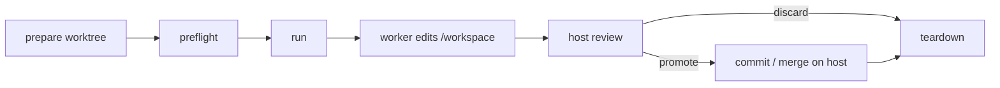

# Delivery Protocol Harness Demo — usage & operations

Operational reference for the [Delivery Protocol Harness Demo](../README.md): each channel in
detail, security posture, attach mode, roles, providers, env vars, host mode,
telemetry, and the orchestrator internals.

- **Concept & quick start** → [`../README.md`](../README.md)
- **Design rationale / architecture** → [`langgraph-orchestrator-design.md`](langgraph-orchestrator-design.md)

## Channels in detail

### Telegram bot (long-running)

One-time setup: **create your own bot** with [@BotFather](https://t.me/BotFather)
for `TELEGRAM_BOT_TOKEN`, and put your numeric id (from
[@userinfobot](https://t.me/userinfobot)) in `TELEGRAM_ALLOWED_IDS` — the allowlist
is fail-closed, and the bot exits at startup when it is empty.

Sends are pinned to a recipient allow-list. Set `TELEGRAM_RECIPIENT_IDS` to the
numeric chat ids the bot may send to. The `egress-gw` proxy validates
`chat_id`/`from_chat_id` on every Bot API send method (`sendMessage`,
`sendDocument`, `forwardMessage`, …) against this list, fail-closed — an empty list
drops all sends. Read-only methods (`getUpdates`, `getMe`, `getFile`,
`answerCallbackQuery`) and file downloads pass. The `tg-bot` profile needs both
`EGRESS_ALLOW_TELEGRAM=1` and `TELEGRAM_RECIPIENT_IDS`.

| Var | Direction | Role |
|---|---|---|
| `TELEGRAM_ALLOWED_IDS` | inbound | Authors the bot accepts messages from (fail-closed). |
| `TELEGRAM_RECIPIENT_IDS` | outbound | Chat ids the proxy allows sends to (fail-closed). |
| `EGRESS_ALLOW_TELEGRAM=1` | egress | Opens `api.telegram.org` through the default-deny (tg-bot profile). |
| `TELEGRAM_API_BASE` | transport | Bot + File API base; compose points it at the proxy. |

```bash
docker compose --profile tg-bot up -d tg-bot
docker compose logs -f tg-bot
docker compose down
```

Talk to the bot in Telegram —
**commands only**; plain text (no `/command`) shows `/help`, it does not start an episode.

| Command | What it does |
|---|---|
| `/goal …` | Full harness episode (writes sandbox, Delivery Protocol cycle). Each goal starts **fresh LLM worker sessions**; a compact summary of the prior run is injected from the last `.harness` artifacts (then cleared). Empty body → error. |
| `/ask …` | Read-only Q&A agent (repovine MCP + file reads, no edits). Follow-up `/ask` **continues the same chat** (separate session from `/goal`). Empty body → error. |
| `/stop` | Interrupt the running **episode** only. |
| `/status` | Idle or running episode; notes open `/ask` session. |
| `/new` | New LangGraph thread + fresh `/ask` chat (stops in-flight episode + ask). Sandbox **files are kept**. |
| `/reset` | Confirm, then stops episode + ask, **wipes sandbox files**, clears all sessions and graph thread. Attach: restores the launch baseline instead ([attach mode](#attach-mode-existing-repository-worktree)). |
| `/help` | Command list (also `/start`). |

One active **episode** and one active **ask** per chat at a time. You can attach a
photo (caption it with `/goal …` or `/ask …`) to include the image.

### HTTP handle (no Telegram — drive from another console)

A Telegram-free entry: a small HTTP endpoint you POST goals to with `curl`. Same
compiled graph — only the trigger differs.

```bash
docker compose --profile http up -d http
docker compose logs -f http
```

From another console:

```bash
curl -s localhost:8080/status
# {"ok":true,"provider":"claude","agents":"auto","busy":false,"episodeBusy":false,"askBusy":false,"currentRun":{…}}
# (named /status for parity with the Telegram /status command; "currentRun" is the live run snapshot)

curl -s localhost:8080/goal -H 'content-type: application/json' \
  -d '{"goal":"add a GET /health route returning { ok: true }"}'
# → { ok, status, replyText, turn, graphNodesTouched }
# Empty/missing goal → 400 {"ok":false,"error":"missing required field \"goal\" …"}

curl -s localhost:8080/ask -H 'content-type: application/json' \
  -d '{"question":"how is theme switching implemented in the frontend?"}'
# → { ok:true, answer:"…", contextSessionId:"ctx-ask-…", thread:"default", sessionId:"…" }
# Read-only agent (repovine MCP + file reads; no /goal protocol).
# Empty/missing question → 400 {"ok":false,"error":"missing required field \"question\" …"}

# Continue the same /ask chat (optional thread key; default "default"):
curl -s localhost:8080/ask -H 'content-type: application/json' \
  -d '{"question":"and where is the toggle in the UI?","thread":"demo"}'
# Start a fresh /ask chat on that thread:
curl -s localhost:8080/ask -H 'content-type: application/json' \
  -d '{"question":"what stack is this?","thread":"demo","new":true}'

# multi-agent + review (each /goal: fresh LLM sessions, prior-run compact summary, .harness wipe):
curl -s localhost:8080/goal -H 'content-type: application/json' \
  -d '{"goal":"build the feature","roles":["backend","frontend"],"review":true,"thread":"demo"}'

# detailed sub-agent specs:
curl -s localhost:8080/goal -H 'content-type: application/json' \
  -d '{"goal":"build the feature","subAgents":[{"role":"backend","scope":["backend"]},{"role":"frontend","scope":["frontend"],"dependsOn":["backend"]}],"review":true}'

# wipe the shared sandbox + reap leftover worker processes + drop /ask sessions
# (HTTP analogue of the Telegram /reset; destructive → requires confirm, idle only;
# attach: restores the launch baseline instead):
curl -s -X POST localhost:8080/reset -H 'content-type: application/json' -d '{"confirm":true}'
# → { ok:true, reset:true }
# Missing confirm → 400; an episode/ask still running → 409 (stop it first, then reset).
```

`POST /task` and body key `task` stay accepted as aliases of `POST /goal` (same
handler, same payload; the wire keeps `task`). One **episode** at a time and one
**ask** at a time (shared sandbox) — a concurrent POST to the same endpoint gets
`409`. `/ask` does not block `/goal` (and vice versa).
HTTP `/ask` sessions are keyed by `"thread"` (in-memory until the container restarts).
Set `HARNESS_HTTP_TOKEN` in `.env` to require `Authorization: Bearer <token>`;
unset, the endpoint is open (fine behind the published loopback port — set a token
before exposing it wider).

### One-off CLI goal

Open [`compose.yaml`](../compose.yaml) first — the hardened sandbox (`x-harness-app`),
egress allow-list (`egress-gw`), and CLI entrypoint are all declared there.

```bash
# All app services use profiles — activate them for build (plain `build` is a no-op):
docker compose --profile cli --profile http --profile tg-bot build

docker compose --profile cli run --rm cli --goal "build a todo app"

# optional flags (passed through to scripts/langgraph-cli.mjs):
docker compose --profile cli run --rm cli --goal "wire the API" --roles frontend,backend --review
```

The CLI exits `0` only when the run **completed and passed compliance** (in
multi-agent mode: every sub-agent), so it doubles as a CI gate.

## Security posture (write-only, egress-restricted, hardened by default)

The harness is locked down to **an isolated sandbox that can reach only the LLM API**:

- **No Docker-in-Docker, no privileged container.** The write-only worker runs no
  containers, so the demo ships no daemon to escape from — the biggest residual
  risk of the old DinD design is simply gone.
- **Egress allow-list.** The harness shares an `egress-gw` sidecar's network
  namespace (`network_mode: "service:egress-gw"`). The gateway runs dnsmasq +
  ipset + iptables: it resolves only via the upstream, tags the allow-listed
  domains' IPs into an ipset, and **default-denies all other egress**. Default
  `ALLOW_DOMAINS` is `anthropic.com` only. `api.telegram.org` opens when the
  `tg-bot` profile sets `EGRESS_ALLOW_TELEGRAM=1`. Orchestrator **runtime_check**
  (dependency install + build/test) needs npm and GitHub asset hosts; add
  `registry.npmjs.org`, `api.github.com`, and the `githubusercontent.com`
  release-asset hosts to `ALLOW_DOMAINS` to enable it. At startup and in the
  compose healthcheck the gateway verifies anthropic egress works and `example.com`
  stays blocked. The default-deny is app-agnostic and transparent, and
  **fail-closed** — an unlisted domain is dropped, not leaked. Only the gateway
  holds `NET_ADMIN`; the harness keeps `cap_drop: [ALL]`.
- **Credential custody.** The real Anthropic credential lives in the `egress-gw`
  service env, never in the worker. `egress-gw` runs a loopback origin proxy
  ([`docker/egress-gw/proxy.mjs`](../docker/egress-gw/proxy.mjs)). The worker sets
  `ANTHROPIC_BASE_URL` to the proxy (`http://127.0.0.1:8788`) and carries only a
  **placeholder** token; the proxy overwrites the auth header with the real
  credential and re-originates to `api.anthropic.com` over HTTPS, streaming SSE
  through. The Telegram bot token is custodied the same way, and the proxy pins
  every outbound `chat_id` to `TELEGRAM_RECIPIENT_IDS`. A compromised worker
  reaches the proxy but holds no usable secret and cannot pick an egress target.
- **Write-only worker.** The agent creates and edits files; the container
  default-denies network egress from executed commands, and the prompt tells it to
  write code, not run it.
- **Defense-in-depth on the container:** `read_only` rootfs, `cap_drop: [ALL]`,
  `no-new-privileges`, writable surface limited to `tmpfs` (`/tmp`, `/home/node`)
  and the `./.workspace` bind mount. Non-root `node` user (uid 1000) — so it
  cannot fix bind-mount ownership itself.
- **`workspace-init` (one-shot, before harness services).** A minimal Alpine
  sidecar runs as root with only `CHOWN` added back, normalizes ownership on
  `./.workspace` (pre-created by `scripts/compose.mjs` as the invoking user), then exits.
  On an existing workspace already owned by uid 1000 (normal after prior runs),
  init skips recursive `chown` — a blanket `chown -R` would fail under
  `cap_drop:[ALL]+CHOWN` on mode-700 SDK caches such as `.harness-home/.claude`.
  See [`docker/init-workspace.sh`](../docker/init-workspace.sh).
- **Resource ceilings** (`mem_limit` / `cpus`) cap host blast radius.

If your provider needs a domain that's not listed, the LLM call is dropped
(fail-closed) — add it to `ALLOW_DOMAINS` and watch for blocked lookups with
`docker compose logs egress-gw`. If your host forces an internal resolver, set
`UPSTREAM_DNS`.

You run the project the agent wrote **yourself, on your host** — review its
generated `docker-compose.yml` before `docker compose up` (see *Inspect what the
agent built*). Letting the **agent itself run things** (not recommended) means
widening the container guards — add domains to `ALLOW_DOMAINS` for egress; see
*Sandboxing & process cleanup* for the verify-sandbox knob.

> **Residual risk.** Egress is restricted to `anthropic.com`, and the worker holds
> only a placeholder token with `ANTHROPIC_BASE_URL` pointed at the custody proxy —
> the real credential lives in the `egress-gw` env. A compromised agent reaches the
> proxy but cannot exfiltrate the key or pick another egress target. True
> hostile-input isolation (untrusted goals, multi-tenant) needs VM-grade
> separation — gVisor / Kata / microVM — a per-host upgrade, not a demo default.
> For trusted single-user use, this posture is sufficient.

## Attach mode (existing repository worktree)

`HARNESS_TARGET_MODE=attach` runs the harness against a pre-created linked Git
worktree of an existing repository (mode matrix and mount table:
[README → Target modes](../README.md#target-modes)).
[`scripts/attach-launcher.mjs`](../scripts/attach-launcher.mjs) is the supported
entrypoint — it preflights and creates the launch state before any docker call.
Attach services live in `compose.attach.yaml`, so a bare `docker compose --profile
attach-*` on the main file alone selects nothing; a stacked `docker compose -f
compose.yaml -f compose.attach.yaml --profile attach-*` with hand-set env bypasses
the preflight and is an unsupported operator override.



### Walkthrough

The repository must carry committed `repovine.config.json` and
`repovine.annots.json` (`repovine.domains.json` optional) — in-container
validation refuses to start without them, and the harness never writes stubs.

```bash
# 1+2. Prepare a launch from the checkout path — a detached linked worktree plus
#      an empty state dir, auto-named <repo>-run-NNN. The launch is recorded in
#      .attach-launch.json; preflight/run resolve it, so no exports are needed.
npm run attach -- prepare ~/workspace/myrepo            # [--base <ref>] [--name <run-name>]
# attach prepare OK: myrepo-run-001 @ <oid>
# Placement defaults to <parent-of-checkout>/.repovine-harness-worktrees|.repovine-harness-state;
# HARNESS_ATTACH_ROOT=<dir> (settable in .env) switches to <dir>/worktrees|state.
# prepare is ADDITIVE only (its one source-side write is git's own worktree
# registration); teardown stays manual. The manual equivalent:
#   git -C ~/workspace/myrepo worktree add --detach ~/worktrees/myrepo-run-001
#   mkdir -p ~/attach-state/run-001    # dedicated and EMPTY — one per launch
#   export HARNESS_ATTACH_WORKTREE=… HARNESS_ATTACH_STATE_DIR=…   # overrides the pointer

# 3. Validate (creates nothing):
npm run attach -- preflight
# attach preflight OK: worktree=… state=…

# 4. Launch — full preflight again, then state layout, then compose:
npm run attach -- run cli --goal "add a healthcheck endpoint"
# long-running channels (no extra args): npm run attach -- run http | run tg-bot

# 4b. Continuation: keep sending goals to the running bot — episodes accumulate
#     in the same worktree. To rebuild the image (new demo code) or bring a
#     killed bot back on the SAME launch, use restart (run refuses a non-empty
#     state; restart preserves the worktree + baseline):
npm run attach -- restart tg-bot

# 5. Review on the host:
git -C ~/worktrees/myrepo-run-001 status
git -C ~/worktrees/myrepo-run-001 diff

# 6a. Promote (fetch-based): a successful run is committed into the disposable
#     repo as attach/run-<id> — the reply shows `📦 attach/run-<id> @ <oid>`.
#     Fetch it into the checkout and merge:
git -C ~/workspace/myrepo fetch ~/attach-state/run-001/runtime/git attach/run-<id>:attach/run-<id>
git -C ~/workspace/myrepo merge attach/run-<id>

# 6b. Alternative — worktree file flow: commit the files in the worktree. It
#     shares refs/objects with the source repo, so the branch is immediately
#     mergeable from the checkout — no push, no remote:
git -C ~/worktrees/myrepo-run-001 switch -c attach/run-001
git -C ~/worktrees/myrepo-run-001 add -A
git -C ~/worktrees/myrepo-run-001 commit -m "attach run-001: <what changed>"
git -C ~/workspace/myrepo merge attach/run-001   # or: git cherry-pick <sha>

# 6c. Discard instead: skip 6a/6b and use --force on worktree remove below.

# 7. Teardown, in this order (fetch before removing the state dir — it holds the
#    disposable repo):
npm run docker:down                         # stops every profile (attach lives in compose.attach.yaml)
rm -rf ~/attach-state/run-001
git -C ~/workspace/myrepo worktree remove ~/worktrees/myrepo-run-001   # --force when discarding
git -C ~/workspace/myrepo branch -d attach/run-<id>                    # after merge
```

Small uncommitted diffs can skip the branch: `git -C <worktree> diff | git -C <checkout> apply`
(untracked new files are not in `git diff` — use the branch flow for those).
`repovine.annots.json` travels with the commit like any committed artifact; when the
checkout's copy changed in parallel, resolve it with the engine's annotation merge
tools instead of a file-level overwrite.

`/reset` restores the workspace to the launch baseline: `git reset --hard
attach-baseline`, then `git clean -fdxq -e .harness -e .repovine`. The confirm
flow matches sandbox (Telegram button / `confirm`, HTTP `{"confirm":true}`).
Committed `attach/run-*` branches survive a reset. A workspace without the
baseline tag fails loud (the tag exists only in launcher-prepared state).

The engine comes from the image (`REPOVINE_CLI`); a repovine binary inside the
worktree's `node_modules` is never auto-executed. Chat attachments land under
`.harness/attachments/` in both modes — in attach that is the external runtime
mount, so images never enter the worktree diff.

### What attach refuses

In-container Git works against the disposable repo (`git status` / `diff` /
`log` over the `attach-baseline` tag, own commits), and `/reset` is a
confirm-gated baseline restore (see the walkthrough). Attach still refuses:

| Operation | Observable behavior |
|---|---|
| repovine stub seeding | startup fails: `missing repovine.config.json — … the harness never writes stubs` |
| Git against the source repository | the common dir is never mounted; `/workspace/.git` is a read-only pointer into the disposable repo — the agent cannot repoint it |
| recursive chown | no `workspace-init` service in attach profiles; the container runs as `HARNESS_HOST_UID:HARNESS_HOST_GID` |
| worktree parallelism | sequential stages with refresh barriers (`gitOperationsAllowed=false`) |

In-container validation ([`lib/target-repo.mjs`](../lib/target-repo.mjs))
re-proves what it can: the byte-exact read-only pointer (`gitdir: /state/git`),
a writable disposable repo with a resolvable HEAD at `/state/git`, a present and
writable `repovine.config.json`, a `repovine.annots.json` that parses, writable
runtime mounts. Worktree provenance is the launcher's job — that evidence stays
host-side. The local adapter's `apply_patch` runs `git apply` in the workspace
repo (both modes).

The explore and implement CSQ gates are graded by harness-owned calibration in
both modes: those sub-agent assignments carry
`contextSession.qualityThreshold` / `warningThreshold` / `byteBudget`
(`CSQ_CALIBRATION` in [`lib/target-repo.mjs`](../lib/target-repo.mjs)), and the
engine gives assignment fields precedence over the workspace config.
Annotate-phase assignments carry `byteBudget` alone and set `required: false` —
CSQ is advisory there, and its thresholds come from the workspace config or the
engine defaults. The target repo's committed `repovine.config.json` keeps the
rest of `contextQuality` (enforcement mode, `recoveryWindow` — config-only
knobs).

### Observability

| Surface | Attach signal |
|---|---|
| CLI startup | `Target mode:  attach` and `Workspace:    /workspace` lines |
| HTTP / Telegram startup log | `Target mode: attach. Workspace: /workspace` |
| `GET /status` | `targetMode: "attach"`, `resetAllowed: true`; `workspace` when authorized |
| Successful-run reply | `📦 attach/run-<id> @ <oid> — fetch from the checkout to promote` |
| Telemetry (`active/current-run.json`, `runs/<runId>/summary.json`) | `targetMode` and `workspace` fields |
| Telemetry events (`active/events.jsonl`) | `attach_commit` with `runId`, `branch`, `oid` |

### Preflight checks

`run` re-runs the full preflight every time. Each failure prints one line naming
the check and exits non-zero before any docker invocation.

| Check | Rejects |
|---|---|
| `attach-env` | unset / relative / unresolvable `HARNESS_ATTACH_WORKTREE` or `HARNESS_ATTACH_STATE_DIR`; identical paths; not a directory |
| `path-overlap` | worktree ⟷ state dir nesting; either path containing — or inside — the git dirs or the source checkout |
| `git-pointer` | missing `.git`; `.git` is a directory (primary checkout); pointer without `gitdir: ` |
| `git-resolve` | per-worktree git dir / common dir do not resolve; `git worktree list` / `rev-parse` failures |
| `state-empty` | non-empty state dir — each launch needs a fresh empty one |
| `mount-table` | a host mount point strictly below the worktree or the state dir; unreadable `/proc/self/mountinfo` (Linux host required) |
| `worktree-walk` | sockets / FIFOs / device nodes; hardlinked regular files (`nlink > 1`). Symlinks pass and are never followed |
| `worktree-registration` | worktree is not the checkout toplevel, is unregistered, or is the main checkout entry (linked worktrees only) |
| `worktree-clean` | dirty or untracked paths — pre-existing changes must not be confusable with agent output |
| `operation-marker` | merge / rebase / cherry-pick / revert / bisect markers in the per-worktree git dir. A main checkout mid-rebase does not block |
| `ownership` | non-numeric `HARNESS_HOST_UID` / `HARNESS_HOST_GID`; worktree or state dir owned by another uid, or not writable |
| `mode-profile` (`run` only) | unknown run command; `HARNESS_TARGET_MODE` set to anything other than `attach` |
| `baseline-repo` (`run` only) | disposable-repo prep under `$HARNESS_ATTACH_STATE_DIR/runtime/git` fails (git init / add / commit / tag), or `attach-baseline` does not resolve |

## Roles & sub-agents

**Role briefs (demo source of truth):** edit markdown under [`lib/agents/`](../lib/agents/)
— `sample.project-subagent.md` (single sub-agent default), `frontend.md` / `backend.md` /
`infra.md` (multi-agent sub-agents), `repo-explorer.md` (read-only exploration),
`annotation-writer.md` (annotation sync/onboarding), and `code-reviewer.md`
(optional review sub-agent). The harness injects these into worker prompts; they are
**not** written into `sandbox/`. Docker bind-mounts `./lib/agents` by default
(`HARNESS_AGENTS_HOST_DIR` / `HARNESS_AGENTS_DIR` in `.env`) — edit on the host and
restart the service; no image rebuild. Without the mount, briefs come from the image
`COPY` and need `docker compose build`.

**Custom sub-agent (sandbox):** not automatic from dropping a file — register the role in
[`lib/agents.mjs`](../lib/agents.mjs) (`ROLES` + filename), add `lib/agents/<role>.md`, then
`--goal "…" --roles <role>` (CLI), `{"roles":["<role>"]}` or detailed
`{"subAgents":[{"role":"<role>","scope":["path"]}]}` (HTTP), or `@<role>` in goal text
(Telegram / `AGENTS=auto`). Changing `lib/agents.mjs` still requires an image rebuild.

**Project roles (attach):** the attached repository registers its own roles in
`repovine.config.json`:

```json
"agents": { "roles": { "acme-backend": { "brief": ".cursor/agents/acme-backend.md", "scope": ["services/api"] } } }
```

The brief file goes into the worker prompt **byte-for-byte** (frontmatter
included) — one file serves the IDE client and the harness. At launch the
catalog replaces the bundled `frontend`/`backend`/`infra` with the project roles
(utility roles `default`/`review`/`repo-explorer`/`annotation-writer` stay) and
is read from the **launch baseline** (`agents roles --at attach-baseline`) — an
agent editing a brief mid-launch changes its diff, never its own next prompt.
Updating roles = commit + new `prepare`. A repository without the section keeps
the bundled fallback (logged). Validation is fail-loud: protocol markers or an
embedded result block in a brief abort startup. `@acme-backend` mentions,
`--roles acme-backend`, and the LLM planner all route against this catalog; a
planner naming an unknown role invalidates that plan (recorded reason +
deterministic fallback) instead of silently degrading.

Ownership boundary — what lives where (the axis is repository vs environment,
like `CODEOWNERS` vs editor settings):

| Repository (`agents.roles` — committed, versioned, in the baseline) | Harness (JS registry / env — execution policy) |
|---|---|
| role id, description | app frame (`HARNESS_APP_FRAME`) |
| brief path + prose (the role's knowledge) | test gates (`HARNESS_REQUIRE_TESTS_ROLES`) |
| default scope (ownership paths; the plan may widen per task) | model routing (`*_REASONING`), phases, CSQ calibration |
| — | scheduling, retries, review policy |

The engine is the broker: it parses and validates the section
(`repovine agents roles`) and serves neutral facts; this harness is one
consumer, client projections or another harness can read the same source.
Reserved ids `default`/`review`/`repo-explorer`/`annotation-writer` cannot be
shadowed by a project role.

**Inter-sub-agent handoff (`handoff.md`):** demo-owned markdown at
`lib/handoff/handoff.md` (the structure is guarded by the demo test suite). The
loader only reads markdown; override with `HARNESS_HANDOFF_DIR` (default `lib/handoff/`).

## Inspect what the agent built

The sandbox is **bind-mounted to the host** at `./.workspace` (gitignored), so the
files the agent created are right there:

```bash
ls -R .workspace/sandbox          # what the agent wrote
ls .workspace/sandbox/.harness    # the protocol artifacts (assignment, result, verdict)
```

Override the host location with `HARNESS_WORKSPACE_DIR` in `.env`.

## Auth in Docker

Credentials come **only from `.env`**. For `claude`, set `CLAUDE_CODE_OAUTH_TOKEN`
(preferred — from `claude setup-token`) or `ANTHROPIC_API_KEY`; the OAuth token has
a smaller blast radius (subscription rate-limit, not open billing) and is easy to
revoke. In Docker the credential is consumed by the `egress-gw` custody proxy: the
worker env carries only a placeholder plus `ANTHROPIC_BASE_URL` pointed at the
proxy, which injects the real `Authorization`. `local` needs no cloud key — just
`LOCAL_BASE_URL`. No home login dirs are mounted in Docker; host mode reads the
same `.env` (or the shell).

**Requirements:** Docker Compose v2 and a Linux container runtime. No KVM, no
privileged containers. The `egress-gw` sidecar needs the `NET_ADMIN` capability
(granted in compose) and the `ip_set` kernel module — present on Linux distros,
the Docker Desktop LinuxKit VM, and the Docker Desktop WSL2 backend. No other host
setup — just Docker + Compose.

## Platform support

This is the maintained reference-example runtime surface (the engine/package
surface has its own contract: `docs/platform-support.md` in the repo root). The
runtime is the Linux container (multi-arch: amd64 + arm64/Apple Silicon), and
each mode carries its own host contract — a status always names a mode.

| Mode | Linux | macOS (Docker Desktop) | Windows WSL2 | Windows native |
|---|---|---|---|---|
| **Sandbox** (default) | Reference | Expected: LinuxKit VM ships `ip_set`; runtime smoke pending | Expected: run from the WSL **ext4** filesystem (`~/…`), not `/mnt/c`; the WSL2 backend has `ip_set`; runtime smoke pending | Expected: Docker Desktop with Linux containers; PowerShell/path smoke pending. Native Windows containers are out of scope |
| **Attach** | Reference | Unsupported: trust checks read `/proc` mount topology. The lifting design is [ADR 0001](adr/0001-macos-attach-mount-topology.md), status Proposed; attach refuses until it is accepted, implemented, and proven on real hardware | Expected: ext4 checkout only, enforced by fs-type from the mount table (9p/drvfs/virtiofs refuse; the path string is irrelevant); runtime smoke on a real WSL2 host pending | Unsupported: use WSL2 (prepare and preflight fail early) |
| **Host mode** (dev only, below) | Dev only | Dev only: the process reaper reads `/proc` and is a no-op here | Dev only, as Linux | Unsupported: fails at worker dispatch (POSIX `/bin/sh` process model); use WSL2 or the sandbox |

`Expected` reads as: configuration and image support the host; promotion waits
on an actual-container smoke on that host. Promote an `Expected` cell after
`HARNESS_DOCKER_SMOKE=1 npm run test:egress-smoke` and `npm test` (the render
matrix) run green on that host, recording the IPv6 leg's pass-or-named-skip
status. Hosted CI runners have no Docker on macOS or Windows native, so those
smokes stay manual on real machines.

### Workspace ownership across hosts

The sandbox container runs as uid 1000 on every host. `scripts/compose.mjs`
pre-creates `.workspace` as the invoking user; `workspace-init` normalizes
ownership to `HARNESS_UID`/`HARNESS_GID` (numeric passthrough, default 1000, no
name mapping). Effect on host-visible ownership depends on the file-sharing layer.

| Host | Ownership model | HARNESS_UID/GID effect |
|---|---|---|
| Linux / WSL2 (ext4) | real Unix ownership | container writes land as uid 1000; host-visible uid-1000 files are the sandbox contract |
| macOS Docker Desktop | VM file sharing (VirtioFS/gRPC-FUSE) emulates ownership | files surface owned by the desktop user; in-container chown does not translate to host ownership |
| Windows Docker Desktop | NTFS has no Unix ownership | the share presents a fixed emulated uid; chown is a no-op or `EPERM`; the knobs have no host-side effect |

On the emulated shares `workspace-init`'s chown is a no-op; the in-container
writability probe (`lib/target-repo.mjs`) is the correctness gate and names the
path and uid on failure.

## Run (host — dev only)

Prefer Docker above. Host mode skips egress-gw, read-only rootfs, and cap_drop.
Entry scripts live under `scripts/` (not the demo root).

Build repovine once so the CLI exists, then install provider SDKs:

```bash
(cd repovine && npm run build)
cd repovine/examples/delivery-protocol-harness-demo && npm install
```

All three host entries (`dev:cli`, `dev:http`, `dev:tg-bot`) read the project
`.env` (inline env vars override it), so `cp .env.example .env` once is enough.

```bash
# CLI goal:
npm run dev:cli -- --goal "add a GET /health route"                       # uses .env
LLM_PROVIDER=local LOCAL_BASE_URL=http://localhost:11434/v1 npm run dev:cli -- --goal "…"  # or pass inline

# HTTP handle (reads .env; listens on :8080, PORT=… to override):
npm run dev:http
#   curl -s localhost:8080/status

# Telegram bot:
npm run dev:tg-bot
```

`scripts/langgraph-tg-bot.mjs` also loads `~/telegram.env` (after `.env`, before the
environment) for `TELEGRAM_BOT_TOKEN` / `TELEGRAM_ALLOWED_IDS`.

## Providers

| `LLM_PROVIDER` | Runtime | Auth (explicit key) |
|---|---|---|
| `claude` | Claude Agent SDK | `CLAUDE_CODE_OAUTH_TOKEN` (preferred) or `ANTHROPIC_API_KEY` |
| `local` | own loop over OpenAI-compatible chat (Ollama, vLLM, LM Studio, llama.cpp) | none — `LOCAL_BASE_URL` (key optional) |

Worker timeout defaults to 10 minutes (`WORKER_TIMEOUT_MS=600000`). Provider
overrides still win: `CLAUDE_AGENT_TIMEOUT_MS`, `LOCAL_TIMEOUT_MS`.

`/ask` uses the same provider with a read-only tool set; default timeout
`ASK_TIMEOUT_MS=600000` (also `ASK_MAX_TURNS`).

Harness daemon logs include app-side ISO timestamps by default. Set
`HARNESS_LOG_TIMESTAMPS=0` to restore the old terse prefix-only format. Claude
verbose streams print tool/status events.

### Local models (`local` — Ollama / any OpenAI-compatible endpoint)

`LLM_PROVIDER=local` runs **any tool-capable open model** (Qwen, Mistral, Llama,
DeepSeek, …) through an OpenAI-compatible `/v1/chat/completions` endpoint — **no
cloud key and no vendor SDK**. The model is config, not code: switch Qwen→Mistral by
changing one env var. The adapter (`lib/workers/local.mjs`) runs its **own** agent
loop: native `tool_calls` (with an inline ` ```tool_call ` fenced fallback for models
that leak the call into text), structural file ops (`read_file` / `write_file` /
`apply_patch`) plus a sandbox `run_shell`, and the **repovine MCP** tools exposed as
`mcp__repovine__*` function tools — parity with the SDK workers.

| Env | Default | Meaning |
|---|---|---|
| `LOCAL_BASE_URL` | — (**required**) | OpenAI-compatible base. Under Docker the fixed `http://127.0.0.1:11434/v1` (gateway forward); on the host `http://localhost:11434/v1` (Ollama). Its presence is the whole "credential" — auth is **not** fail-closed; no remote spend is possible. |
| `LOCAL_MODEL` | `qwen2.5-coder:32b` | Model id. Switching models needs no code change. |
| `LOCAL_API_KEY` | — (optional) | Bearer token; most local runtimes ignore it. |
| `LOCAL_PLANNER_MODEL` / `LOCAL_IMPLEMENTER_MODEL` / `LOCAL_VERIFY_MODEL` / `LOCAL_ASK_MODEL` | `LOCAL_MODEL` | Optional per-role model — let a cheap model plan and a stronger one implement. |
| `LOCAL_TIMEOUT_MS` | `600000` | Hard run cap (also honors `WORKER_TIMEOUT_MS`). |
| `LOCAL_MAX_TURNS` | `40` | Tool-use turns before a partial result. |
| `LOCAL_CONTEXT_TOKENS` | `24000` | Soft prompt-token budget. The harness owns the loop for `local` (the SDK workers let the vendor compact), so it evicts the oldest tool rounds — pinning the system prompt + task — as the live prompt approaches this. Raise it for a long-context model (set near the real window minus room for the answer); `0` disables compaction. |
| `LOCAL_TEMPERATURE` | `0` | Sampling temperature (deterministic tool use by default). |

**Run a model + point the harness at it.** Two layouts, both supported:

*Harness in Docker, Ollama on the same host/VM* (the egress-gw default-deny is in play):

```bash
# On the host — bind 0.0.0.0 so containers can reach it, not just loopback:
OLLAMA_HOST=0.0.0.0:11434 ollama serve &
ollama pull qwen2.5-coder:32b           # or :7b on CPU-only / modest hardware

# .env — the same string on Linux, Docker Desktop (macOS), and WSL2:
#   LLM_PROVIDER=local
#   LOCAL_BASE_URL=http://127.0.0.1:11434/v1
#   LOCAL_MODEL=qwen2.5-coder:32b
#   EGRESS_ALLOW_HOST_DOCKER_INTERNAL=1
docker compose --profile cli run --rm cli --goal "add a GET /health route"
```

The gateway proxy listens on `127.0.0.1:11434` inside the shared netns and forwards to
`host.docker.internal:11434`, resolved gateway-side via `extra_hosts`. `LOCAL_BASE_URL`
is the fixed `http://127.0.0.1:11434/v1`. `EGRESS_ALLOW_HOST_DOCKER_INTERNAL=1` opens the
firewall for the forward leg and allow-lists the whole host interface IP.

Three knobs adjust the forward target; `LOCAL_BASE_URL` stays constant:

| Env | Default | Meaning |
|---|---|---|
| `PROXY_LOCAL_PORT` | `11434` | Loopback port the proxy exposes in the shared netns. |
| `LOCAL_UPSTREAM_HOST` | `host.docker.internal` | Forward target. An IP reaches a model on another machine, paired with `EGRESS_ALLOW_CIDRS=<ip>/32`. |
| `LOCAL_UPSTREAM_PORT` | `11434` | Forward target port, e.g. `1234` for LM Studio. |

Verify from inside the netns (the forwarder is a byte pipe, so non-`/v1` paths pass too):

```bash
docker compose --profile cli run --rm --entrypoint sh cli \
  -c 'curl -s http://127.0.0.1:11434/api/version'
```

`test/local-endpoint.test.mjs` covers the forward: a Tier-1 mock-upstream test always
runs, and a Docker-gated tier brings the gateway up against a mock model.

*Harness on the host* (`npm run dev:cli` — egress-gw not involved): just
`LOCAL_BASE_URL=http://localhost:11434/v1`.

Run the model server (Ollama, etc.) on the host or another machine, not in this compose
project — an in-compose model service would bind `:11434` on the Docker host and collide
with a real Ollama, and the egress-gw default-deny is built for cloud egress, not an
internal service.

**Cold start.** A big model's FIRST request pays a model-load cost (a 32B model is
~20 GB to page in) on top of processing the full tool schema, so it can far exceed a
tight per-request timeout — raise `LOCAL_REQUEST_TIMEOUT_MS` (default 5 min) and keep
the model warm on the server (`OLLAMA_KEEP_ALIVE=-1`, or pre-warm with a `keep_alive`
request). Warm, a 32B model answers in seconds; runs complete normally.

**Honest scope.** This is a vendor-neutral *reference*. It works well with strong
tool-using models (32b-class Qwen / Codestral / Llama). Small models call tools less
reliably and the loop will sometimes stop with a **partial** result — it does **not**
claim to match Claude on edit reliability. The harness checks still apply: a
weak run is rejected by compliance, never rubber-stamped.

### Dev-session telemetry

Each `/goal` writes lightweight operator telemetry under `.harness/`:

- `active/current-run.json` — live run snapshot for `/status` (Telegram command and HTTP `GET /status`).
- `active/events.jsonl` — append-only run events (`plan_finished` — carries `droppedAnnotationRoles`,
  `overPlanAdvisories`, `planReview` when present — `sub_agent_started`, `sub_agent_finished`,
  `runtime_check_finished`, `refresh_context`, `run_usage`, etc.).
- `runs/<runId>/summary.json` — final compact card for the completed run. The card sits under
  `active/<runId>/` while the run is in flight and moves to `runs/<runId>/` when it is archived.

The final CLI/Telegram/HTTP reply includes a one-line `episode:` summary with
elapsed time, measured token/cache/cost usage when the provider exposes it,
fresh-vs-resumed sub-agent cost, and the slowest sub-agent. HTTP `/goal` also returns a
structured `telemetry` object, and `GET /status` includes `currentRun` so another
console can inspect a running dev session without tailing logs.

## Sandboxing & process cleanup

Workers verify their work by running it (build, tests, sometimes a server), and
can leave dev servers / `docker compose` stacks running after the sub-agent
finishes — a verify step can hold file descriptors open on a background process.
Two independent guards handle this:

**Prevention.** In Docker the container is the sandbox: default-deny egress,
read-only rootfs, write-only workspace, `cap_drop: [ALL]`, no Docker-in-Docker. A
verify step cannot reach the network or persist outside the workspace.

*Why the container, not the provider's own sandbox.* The Claude Agent SDK ships a
bubblewrap sandbox, but the container is a **superset** of it: bwrap blocks network
and confines writes; the container does that AND enforces domain-level egress
custody (the egress-gw netns), holds the real API token out of the agent's reach
(the proxy), and pins Telegram recipients — none of which a provider sandbox
provides. So bwrap inside the container would be redundant, and it also cannot
start there (unprivileged user namespaces are disabled). Both reasons point the
same way: `CLAUDE_SANDBOX` defaults to `0` in Docker. That default is what lets
`claude` start, **not** a relaxation — the stronger, harness-owned boundary is
already in force. `failIfUnavailable: true` keeps it honest: a non-`0` value where
bwrap is unavailable is a hard error, never a silent unsandboxed run.

The provider sandbox stays the right tool for **host mode** (`npm run dev:*`),
where there is no container and bwrap is the isolation.

| Setting | Default | Meaning |
|---|---|---|
| `CLAUDE_SANDBOX` (Docker) | `0` | The container already supersedes bwrap; bwrap also cannot start under disabled userns. Setting `1` here hard-fails (by design), it does not add protection. |
| `CLAUDE_SANDBOX` (host, bwrap present) | `1` | Host mode has no container — the per-provider bwrap sandbox is the isolation (blocks network and lasting servers). |

The `local` adapter's `run_shell` executes in the same container sandbox. For a
live "bring the app up and curl it" verification on the host, set
`CLAUDE_SANDBOX=0`.

**Process reaper (cleanup).** After each worker sub-agent the harness snapshots
processes/ports/containers attributable to the sandbox (by cwd under it) and
**always** kills leftovers (`🧹 reaped: …` in the reply). Reaping uses
`SIGTERM`→`SIGKILL`, plus `docker compose down` for the sandbox's compose project.
`/reset` also reaps before wiping. Linux-only (reads `/proc`); a no-op elsewhere.
See [`lib/sandbox-procs.mjs`](../lib/sandbox-procs.mjs).

## LangGraph orchestrator (internals)

The graph owns the Delivery Protocol cycle:

```text
START -> intake -> build_assignment -> validate_assignment -> run_sub_agent
      -> validate_result -> compliance -> runtime_check -> compose_reply
```

LangGraph owns step order, branching, retries, and persisted state; it does **not**
pick the LLM (that is `run_sub_agent` via `LLM_PROVIDER`) and never imports repovine
internals — orchestrator nodes shell out to the CLI. Swapping LangGraph for another
engine means re-wiring these same node functions; the protocol boundary stays put.

Multi-agent episodes fan out through `multi_agent` (plan → sub-agents → review-fix →
**runtime_check** → annotation sync). Agents stay write-only; the orchestrator
runs `npm install --ignore-scripts` in each package directory missing
`node_modules`, then `npm run build && npm test` (or `HARNESS_RUNTIME_CHECK_CMD`)
in the bind-mounted sandbox via `spawnSync` with a scrubbed environment. On
failure, an optional `runtime-fix` sub-agent re-scopes from log paths
(backend/frontend/infra) and re-runs the check. `HARNESS_RUNTIME_CHECK_FIX_MAX`
applies **per failing command** (e.g. `npm run build` and `npm test` each get
their own attempt budget when the failure mode shifts). Annotation sync is gated
on a passing runtime_check. It is **off by default** in Docker (`compose.yaml` sets
`HARNESS_RUNTIME_CHECK:-0` — the hardened egress blocks npm, see Egress below); set
`HARNESS_RUNTIME_CHECK=1` (+ open npm in `ALLOW_DOMAINS`) to enable.

**Attach mode forces runtime_check off.** It would `npm install` + build/test the
whole real repository after every episode (a fresh worktree has no `node_modules`),
which fails closed under the default-deny egress and fails a correct change at the
goal gate. An explicit `HARNESS_RUNTIME_CHECK=1` is reported as overridden in the
intake log, not silently ignored. Build and test an attached repository on the
host after promotion.

**Egress:** runtime_check runs in the harness container (not the write-only worker
sandbox) and shares the egress allow-list. Default `ALLOW_DOMAINS` is
`anthropic.com` only, so dependency install and binary fetches fail closed until
the operator adds `registry.npmjs.org`, `api.github.com`, and the
`githubusercontent.com` release-asset hosts to `ALLOW_DOMAINS`. Installs use
`--ignore-scripts`, and runtime_check does not pass provider keys or token-like
env vars into build commands. Install is skipped in dirs that already have
`node_modules` (e.g. from a prior host install). After changing `ALLOW_DOMAINS`,
restart the running profile, e.g.
`docker compose --profile tg-bot up -d --force-recreate egress-gw tg-bot`.

- Orchestrator nodes call repovine through the CLI wrapper in
  [`lib/repovine.mjs`](../lib/repovine.mjs).
- Worker adapters open repovine MCP inside the provider runtime, scoped to the
  sandbox.
- Missing credentials become a validated `blocked` result instead of silent spend.
- A rejected, non-blocked run with actionable compliance notes is retried once
  (`HARNESS_MAX_RETRIES`, default 1; set `0` to disable).
- `AGENTS=auto` uses the provider planner to split frontend/backend/infra sub-agents;
  `AGENTS=single` runs one worker sub-agent.

Full design rationale: [`langgraph-orchestrator-design.md`](langgraph-orchestrator-design.md).

## Files

| File | Role |
|---|---|
| `compose.yaml` | **Source of truth** for security + opt-in profiles: `cli` / `http` / `tg-bot` / `attach-cli` / `attach-http` / `attach-tg-bot` |
| `Dockerfile` | Node 22; builder stage compiles `dist` from source; runs as non-root `node`, no Docker CLI |
| `docker/egress-gw/` | Egress allow-list gateway image (dnsmasq + ipset + iptables) |
| `docker/init-workspace.sh` | One-shot bind-mount ownership fix (`workspace-init` service) |
| `.env.example` | Env template for compose (copy to `.env`) |
| `scripts/langgraph-cli.mjs` | CLI trigger for the compiled graph (Docker or `npm run dev:cli`) |
| `scripts/langgraph-tg-bot.mjs` | Telegram entry; fail-closed allowlist; `.env` + `~/telegram.env` |
| `scripts/langgraph-http.mjs` | HTTP `/goal` + `/ask` + `/reset` + `/status` entry (Docker or `npm run dev:http`) |
| `scripts/attach-launcher.mjs` | Attach host launcher (`npm run attach`): fail-closed preflight, launch state layout + disposable baseline repo, compose invocation |
| `lib/graph/` | LangGraph state, nodes, workflow, planner, multi-agent sub-agents |
| `lib/assignment.mjs` | Goal → `AgentAssignment` (Delivery Protocol v1) |
| `lib/repovine.mjs` | Single repovine CLI wrapper (delivery: descriptor, validate-*, compliance, run-brief; agents: roles/orient; `repovine build` / `refreshGraph`) |
| `lib/runtime-check.mjs` | Orchestrator dependency install + build/test (`runtime_check`) in the product sandbox |
| `lib/agents/` | Demo role prose briefs (source of truth — edit to customize sub-agents) |
| `lib/agents.mjs` | Role loader (`loadRolePrompt`, `resolveRole`, `AGENTS` mode) |
| `lib/workers/` | Claude + local task workers + read-only `ask-*` agents, auth/prompt helpers |
| `lib/channels/telegram-adapter.mjs` | Telegram long-poll transport and commands |
| `lib/channels/http-adapter.mjs` | HTTP `/goal`, `/ask`, `/reset`, `/status` endpoints |
| `lib/ask.mjs` | Read-only `/ask` router (provider agents, session resume) |
| `lib/target-repo.mjs` | Target modes: sandbox lifecycle + seeding, attach validation + baseline reset, per-mode policy (reset / Git parallelism) |
| `lib/attach-guard.mjs` | Attach Git pointer spec (`gitdir: /state/git`) and baseline tag name, shared by the launcher and in-container validation |
| `lib/sandbox-procs.mjs` | Process/port/container reaper for the sandbox |
| `lib/env-file.mjs` | Minimal `KEY=value` loader for `.env` / home env files |

Runtime output lives under `.workspace/` and is gitignored.
